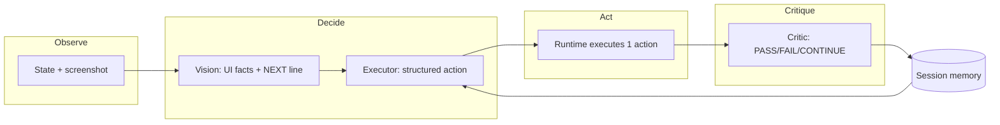

# Autonomous agent “thinking” architecture (portable spec)

This document extracts the **reasoning loop**, **roles**, **prompt contracts**, and **memory** pattern used by Betafy’s AI browser QA agent (`test-executor.service.ts`, `testing-agents.service.ts`, `langchain.service.ts`). You can reuse the same structure in other projects (RPA, game bots, IDE agents, etc.) by swapping the **environment** (Playwright → your API) and **action schema**.

---

## 1. Core idea: Observe → Decide → Act → Critique

The agent is not a single monolithic prompt. It runs a **closed loop**:

1. **Observe** — Capture state (DOM/HTML snippet, URL, title, optional screenshot).
2. **Decide** — One **structured** next step (typed action + selector/value + short reason).
3. **Act** — Deterministic runtime executes that step (no LLM in the hot path).
4. **Critique** — Second structured call judges **PASSED / FAILED / CONTINUE**, optionally advancing a **scripted step cursor**.
5. **Remember** — Append short factual lines to **session memory** so the next iteration stays coherent (“Cursor-like” continuity).

Repeat until pass, fail, max iterations, or unrecoverable error.

---

## 2. Specialist roles (separate model calls)

Each role has a **narrow job** and **lower temperature** than a general chat assistant. Routing different roles to different models (cheaper planner, stronger executor, etc.) is optional but supported.

| Role | When | Input | Output |
|------|------|-------|--------|
| **Planner** | Once per task/session | Full test case / goal | Short natural-language **intent** (2–3 sentences) |
| **Vision (pre-action)** | Each iteration if pixels available | Screenshot + step hints | **Text report** for a blind downstream model; ends with `NEXT: …` |
| **Executor** | Each iteration | DOM + URL + memory + scripted steps + vision block | **Structured** single action (Zod/JSON schema) |
| **Vision (post-action)** | Each iteration after act (for critic) | Screenshot + step expected | **Factual bullets** only (no automation commands) |
| **Critic** | Each iteration after act | Memory + vision block + DOM text + last action | **Structured** `PASSED` / `FAILED` / `CONTINUE` + `advanceScriptedStep` |
| **Error analyst** | On runtime exception | Error + page snapshot + history | **Structured** `shouldRetry` + reason |

**Design principle:** The vision model **describes**; the executor **commits** to one tool/action. That separation keeps multimodal cost controllable and reduces hallucinated selectors.

---

## 3. Session memory (rolling buffer)

- **Structure:** Append-only list of short strings (e.g. max ~26 entries, each truncated ~550 chars).
- **Content examples:** `[plan] …`, `[prefill] …`, `[filled] …`, `[vision N] …`, `[critic N] CONTINUE: …`, `[state] Scripted step focus → …`.
- **Injection:** Last *N* lines (e.g. 12–14) are pasted into **Executor** and **Critic** prompts every iteration.
- **Purpose:** Prevents “amnesia” across iterations; grounds decisions in what already happened without sending full chat history.

---

## 4. Scripted goals without brittle scripts

When the user provides ordered **steps** (action + expected):

- Maintain **`scriptedStepCursor`** (0-based).
- The **Executor** prompt marks **one** step as “WORK ON THIS STEP NOW”.
- The **Critic** returns **`advanceScriptedStep: true`** only when the **current** step’s expected outcome is clearly met **and** more steps remain; the loop then increments the cursor.
- **PASSED** is only when the **last** step (or overall goal) is satisfied.

This yields **guided autonomy**: the LLM explores the UI, but acceptance criteria stay anchored to human-written expectations.

---

## 5. Executor “thinking” protocol (prompt-level)

The Executor is instructed to follow a **fixed cognitive order** every iteration:

1. **Situate** — What screen is this? (Use DOM + vision + URL + memory.)
2. **Align** — Is this the right place for the **current** scripted step? If not, navigate or open the right area.
3. **Identify work** — What interactions or data are needed?
4. **Act** — Emit **exactly one** mapped action.

Additional rules that improve reliability:

- **Observe before act** — No random clicks until the screen is understood.
- **One browser action per iteration** — Multi-step user flows are **chains** of iterations.
- **Trust vision `NEXT:`** when present — It is derived from pixels; DOM may lie on SPAs.
- **Respect `[prefill]` / `[filled]` memory** — Avoid redundant fills.
- **Stable selectors** — Prefer robust locator strategies in your runtime.

---

## 6. Vision contracts

### 6.1 Pre-action: `visionSummarizeUiForExecution`

**Goal:** Produce **facts** for a model that **cannot** see the image.

Suggested sections (all text):

1. Screen / page type  
2. Layout & salient UI (regions, buttons, links, forms, modals)  
3. Fit for the current step (right page or not)  
4. What automation likely needs next  
5. **Mandatory single line:** `NEXT: <one plain-language intent>` (no CSS selectors)

System tone: factual, structured; temperature low (~0.15); image detail high if using API that supports it.

### 6.2 Post-action: `visionEvidenceForCriticStep`

**Goal:** Pixel-grounded **evidence** for pass/fail (complements DOM `innerText`).

- Short bullet list of **observable facts** only.  
- Explicitly **forbid** suggesting Playwright/commands.  
- If ambiguous, one bullet `Unclear: …`

The Critic prompt should say: when vision and DOM disagree, prefer **vision** for what the user **sees**.

---

## 7. Critic “thinking” protocol

Structured judgment with explicit rules, for example:

- **FAILED** — Blocking error, impossible expected state, no reasonable path.  
- **CONTINUE** — Expected for **this** step not met yet (`advanceScriptedStep: false`).  
- **CONTINUE** + **`advanceScriptedStep: true`** — This step met; more steps remain.  
- **PASSED** — Last step met or overall goal achieved.

Include **domain guardrails** in the critic prompt (e.g. security tests: gated login = success, not failure; validation toasts = CONTINUE not FAIL). These reduce false failures from over-literal LLM judging.

---

## 8. Structured outputs (schemas)

Use **strict JSON** (e.g. Zod + `withStructuredOutput`) so the runtime never parses free-form prose for control flow.

**Executor (`ActionDecisionSchema` example):**

- `action` — human-readable description  
- `actionType` — enum: `fill` | `click` | `navigate` | `wait` | `verify` | `complete`  
- `selector` | `value` — nullable where not applicable  
- `reason` — must reflect **page awareness** then **chosen action**

**Critic (`ResultAnalysisSchema` example):**

- `status` — `PASSED` | `FAILED` | `CONTINUE`  
- `reason` — short  
- `advanceScriptedStep` — boolean (explicitly required every time)

**Error path (`ErrorAnalysisSchema` example):**

- `shouldRetry`, `reason`, optional `suggestedAction`

Validate after the LLM returns; if required fields are missing, treat as **no decision** and fail safe (stop or retry policy).

---

## 9. Implementation notes from this codebase

- **Vision + Executor:** When a screenshot exists, the flow is **two calls**: (1) vision → natural language summary with `NEXT:`; (2) text executor → structured action.  
- **DTO `orchestrationMode`:** As of the extracted design, it is reflected in **telemetry**; the executor path above is what runs when screenshots are enabled. If you need true “single-call vision emits JSON actions,” branch on that flag and skip the text executor.  
- **Heuristics alongside LLM:** Optional deterministic pre-steps (e.g. auth gate detection, form prefill) can write into **the same memory buffer** so the Executor stays consistent.  
- **Telemetry:** Tag events with `agent` + `phase` (e.g. `vision` / `decide_action`, `critic` / `analyze_result`) for debugging multi-call pipelines.

---

## 10. Porting checklist

- [ ] Define your **action enum** and **runtime** mapping (browser, HTTP, CLI, etc.).  
- [ ] Define **state capture** (what the Observer returns each tick).  
- [ ] Add **Planner** once per task if goals are complex.  
- [ ] Split **perception** (vision/text summary) from **decision** (structured action).  
- [ ] Add **Critic** with the same structured status + **step advancement** if tasks are multi-step.  
- [ ] Implement **rolling memory** and inject last *N* lines into Executor + Critic.  
- [ ] Use **low temperature** for decision/critic paths; keep prompts **rule-heavy** for edge cases.  
- [ ] Cap iterations and define behavior when the model returns null/incomplete structured output.

---

## Source files (reference)

- `test-executor.service.ts` — main loop, memory, executor/critic/error prompts, schemas.  
- `testing-agents.service.ts` — vision prompt templates for pre-action and critic evidence.  
- `langchain.service.ts` — `TextModelRole` routing (`planner` | `executor` | `critic`) and vision model configuration.  
- `AI_AGENT_THINKING_SOURCE.md` — same folder: **embedded TypeScript** from those files for offline / copy-paste reference (regenerate the verbatim `test-executor` blocks with the Python snippet at the bottom of that file if line numbers shift).
