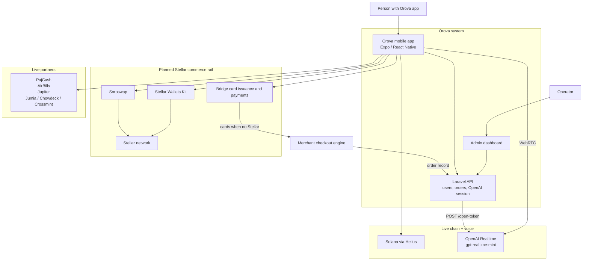

# C4 L1 — System Context

Source: `C4L1SystemContext.drawio.xml`

The high-level context: people, the Orova system (app, Laravel API, admin dashboard), the planned Stellar commerce rail, the live Solana + voice path, and the live partners.

> Laravel stores users and orders. It does not hold Stellar private keys. Solana, voice, and partners stay on the live path.
