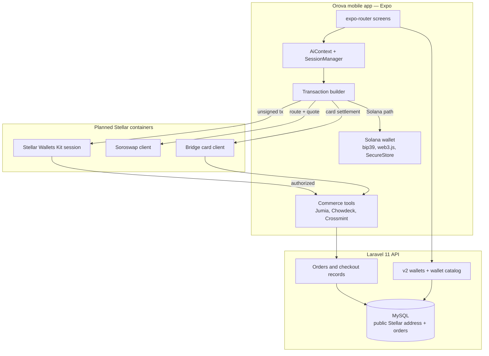

# C4 L2 — Containers

Source: `C4L2Containers.drawio.xml`

Zoom into the Orova system: mobile app internals, the planned Stellar containers, and the Laravel 11 API with MySQL.

> Private keys stay in the user's Stellar wallet. MySQL stores the public address and the order.
