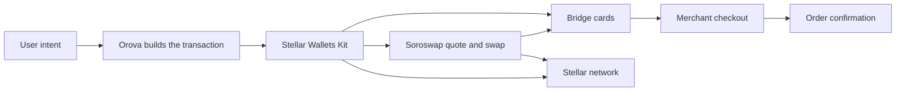
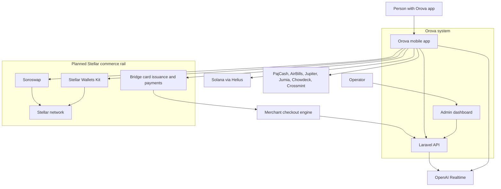
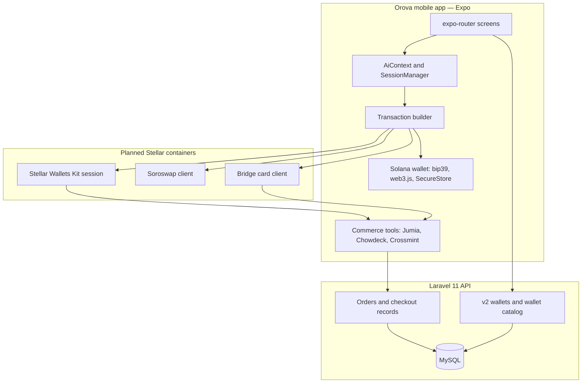
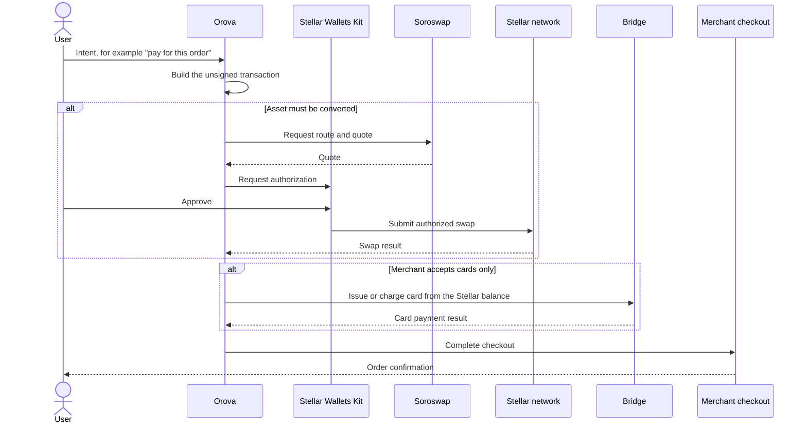
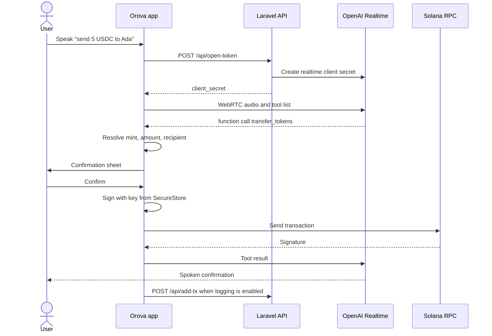

# Technical Architecture Document

[heyorova.com](https://heyorova.com)

**Product:** Orova (package `heysolana`, app version 2.2.1)  
**Document date:** 4 November 2026  
**Scope:** Current implementation across the mobile wallet, Laravel API, admin dashboard, marketing site, speaker-verification service, and desktop voice host.

---

## Contents

1. [Introduction](#introduction)
2. [High-level overview](#high-level-overview)
3. [Definitions, acronyms and abbreviations](#definitions-acronyms-and-abbreviations)
4. [Architecture constraints](#architecture-constraints)
5. [Architecture overview](#architecture-overview)
6. [Planned Stellar integration](#planned-stellar-integration)
7. [C4 L1 — system context](#c4-l1-diagram-high-level-architecture)
8. [C4 L2 — containers](#c4-l2-diagram-zoom-into-the-orova-system)
9. [Sequence — Stellar commerce payment](#uml-diagram-sequence)
10. [Sequence — Solana voice send](#sequence-solana-voice-send)
11. [Deliverables](#deliverables)
12. [On-chain programs](#on-chain-programs)
13. [Technology stack](#technology-stack)
14. [Conclusion](#conclusion)

---

# Introduction {#introduction}

## High-level overview {#high-level-overview}

Orova is a mobile Solana wallet with a voice-first assistant. A person speaks or types what they want — send tokens, swap, buy airtime, pay a bill, cash in or out of Naira, or shop — and the app turns that request into a registered tool call. The model never holds the signing key. The phone builds and signs the Solana transaction after the user confirms.

The assistant is OpenAI Realtime (`gpt-realtime-mini`) over WebRTC. The Laravel API mints the short-lived realtime session so the OpenAI key stays on the server. Chain reads and writes go through Solana RPC (Helius). Partner actions (Jupiter, PajCash, AirBills, Crossmint, Jumia, Chowdeck, MagicBlock, Dextopus) are isolated tool modules inside the app, with the backend proxying the partners that need server-side credentials or scraping.

Store identity is **Orova**. Two build variants share one codebase: `play` (Play Store / general) and `solana-mobile` (Solana dApp Store). Fiat on-ramp and off-ramp are available only where `isFiatExchangeEnabled()` is true for that variant.

**Key features**

- Create or import a BIP39 wallet. The secret phrase is stored in the device secure store (iOS Keychain / Android Keystore), accessible only while the device is unlocked.
- SOL and SPL balances, sends, receives (QR), and Jupiter swaps, with a confirmation sheet before a signature.
- Realtime voice and text chat. The assistant name defaults to Orova and can be renamed in settings.
- Naira on-ramp and off-ramp through PajCash, airtime, data, and electricity through AirBills, and commerce through Amazon (Crossmint), Jumia, and Chowdeck.
- Private SPL payments through MagicBlock, and cross-chain deposit addresses through Dextopus.
- Optional speaker verification (SpeechBrain ECAPA embeddings via a Python service), PIN and biometric unlock, and passkey endpoints on the API.
- Android picture-in-picture overlay and home-screen widgets so the assistant stays reachable outside the app.
- A background Brain that watches conversation and tool activity and can raise local notifications.
- An admin dashboard for users, orders, transactions, pushes, WhatsApp and email campaigns, bug reports, and support chat.
- A desktop Electron host that runs private voice models on the user’s computer and pairs with the phone over QVAC.

**Problems this architecture is built to handle**

- People who want Solana actions in plain language, including users who are new to wallets.
- Keeping signing keys on the device while still letting a cloud model choose which tool to call.
- Combining on-chain transfers with local fiat, bills, and shopping without exposing partner internals in the conversation.
- Operating the same product on Play Store and Solana Mobile builds, with fiat features gated per variant.
- Giving operators a separate dashboard for orders, support, and messaging without putting admin credentials in the mobile app.

## Definitions, acronyms and abbreviations {#definitions-acronyms-and-abbreviations}

| Term | Meaning |
| :---- | :---- |
| Orova | Product name in stores and in the assistant prompt. Package name remains `heysolana`. |
| BIP39 | Mnemonic standard used to create and restore the wallet seed. |
| SPL | Solana token standard. Fungible tokens other than native SOL. |
| RPC | Remote procedure call endpoint used to read accounts and submit transactions. Production reads use Helius. |
| DAS | Digital Asset Standard API (Helius) for token metadata and balances. |
| EAS | Expo Application Services. Used for native builds and over-the-air JavaScript updates. |
| WebRTC | Peer connection that carries microphone audio to OpenAI Realtime and plays the assistant’s audio back. |
| Tool | A JSON-schema function the model can call. Implementations live under `libs/tools/`. |
| SessionManager | Client object that owns the realtime session, dispatches tool calls, and updates the conversation store. |
| Brain | In-app service (`libs/brain`) that observes conversation and tool status and can emit local notifications. It is separate from the realtime voice loop. |
| SecureStore | `expo-secure-store`. Holds the mnemonic with `WHEN_UNLOCKED_THIS_DEVICE_ONLY`. |
| Sanctum | Laravel token authentication used for admin and protected operator routes. |
| FCM | Firebase Cloud Messaging. Push tokens are registered with the Laravel API. |
| ECAPA | SpeechBrain speaker-embedding model (`ecapa-v1`, 192 dimensions) used when voice verification is enabled. |
| VAD | Voice activity detection (Silero) inside the Python service, used to isolate the enrolled speaker. |
| QVAC | Peer pairing used by the desktop voice host so the phone can run Private AI against models on the user’s computer. |
| PIP | Android picture-in-picture / overlay bubble for the assistant. |
| OTA | Over-the-air update shipped with `eas update` without a new store binary. |
| MPC | Multi-party wallet API on the backend (share B release, passkey, device link). The current mobile app does not call these routes. The shipped wallet is the on-device mnemonic. |
| PajCash | Fiat partner for Naira on-ramp and off-ramp into SPL tokens. |
| Jupiter | Swap aggregator used for quotes and token swaps. |
| MagicBlock | Private payment integration (deposit, transfer, withdraw, balance) called from the app. |
| Dextopus | Cross-chain deposit-address and quote integration. The user-facing flow is “receive on another chain”; routing stays inside the tool. |
| Stellar Wallets Kit | Planned. Connects a Stellar wallet and collects authorization. The assistant builds the transaction and never receives the private key. |
| Soroswap | Planned. Stellar liquidity and asset conversion. Orova requests a route and quote, then submits the authorized transaction. |
| Bridge | Planned. Card issuance and card payments so a Stellar balance can pay a merchant that only accepts cards. |

## Architecture constraints {#architecture-constraints}

Orova is a non-custodial mobile client plus a coordinating API. The API stores users, orders, push state, and voice profiles. It does not store the user’s Solana secret for the default wallet.

### Regulatory and partner constraints

1. Fiat on-ramp and off-ramp depend on PajCash. Bank-account resolution, Naira payout, and any identity checks that partner requires happen on the partner side. The app collects amount, token, bank, and account number, then confirms the resolved account name once before `confirmed: true`.
2. Commerce partners (Crossmint, Jumia, Chowdeck) have their own order, delivery, and payment rules. The app records and displays orders; it does not replace those merchants’ fulfilment systems.
3. Speaker verification is optional and off unless `EXPO_PUBLIC_VOICE_VERIFICATION_ENABLED` is true. When it is off, hold-to-talk is the voice control. When it is on, enrolled-speaker checks can gate sensitive commands.
4. Two distribution channels exist. The Solana Mobile variant can hide fiat exchange. Prompts and the tool list both follow that flag, so the model is not offered tools the build cannot run.

### Technical constraints

1. **Network.** Voice, swaps, and sends need a working connection to the Laravel API, Solana RPC, and the relevant partner. The app surfaces tool status in the conversation store so a failed call is visible in chat.
2. **Device limits.** Signing, SecureStore, microphone, biometrics, and the Android overlay all depend on OS permission and hardware. The secret is device-bound (`WHEN_UNLOCKED_THIS_DEVICE_ONLY`). A reinstall without a backup phrase or cloud backup cannot recover the key.
3. **Key handling.** Modern builds keep the mnemonic only in SecureStore. Older builds that left it in AsyncStorage are migrated on launch (`initWallet`) and the legacy blob is removed. Public key and settings stay in Zustand, persisted with AsyncStorage.
4. **Model boundary.** The realtime model selects a tool and arguments. Transaction bytes are built in tool code on the device. Confirmation sheets (`ConfirmActionSheet` and the global sheet) sit in front of sends, swaps, and purchases.
5. **Secrets placement.** `OPENAI_API_KEY` lives on Laravel. The phone calls `POST /api/open-token` and receives a short-lived client secret. Partner secrets that must not ship in the app stay on the server.
6. **Active tool set.** Kalshi and Bayse tool classes exist in the repo and are commented out of `toolRouter`. Jumia admin order routes in `routes/api.php` are paused. The architecture description below follows the tools that `toolRouter` actually returns.
7. **Backend shape.** The API is one Laravel 11 application on Railway with MySQL, database cache, database sessions, and a database queue. It is a modular monolith (route files per area), deployed as a PHP-FPM + Nginx service, with optional worker and cron services. It is not a Kubernetes microservice mesh.
8. **Regional product surface.** Naira (PajCash, AirBills, Jumia, Chowdeck) is a first-class path. The assistant prompt is English unless the user asks otherwise. Currency and partner coverage follow what those integrations support.

---

# Architecture overview {#architecture-overview}

The mobile app is the system of record for keys and signatures. Laravel is the system of record for accounts, orders, campaigns, support, and the OpenAI session. External networks (Stellar, Solana, partner APIs, OpenAI, FCM) sit outside both.

Architecture diagrams are drawn in the same style as [`QvacOverview.drawio.xml`](QvacOverview.drawio.xml). Each diagram is its own diagrams.net file:

1. [`StellarPaymentFlow.drawio.xml`](StellarPaymentFlow.drawio.xml)
2. [`C4L1SystemContext.drawio.xml`](C4L1SystemContext.drawio.xml)
3. [`C4L2Containers.drawio.xml`](C4L2Containers.drawio.xml)
4. [`StellarCommerceSequence.drawio.xml`](StellarCommerceSequence.drawio.xml)
5. [`SolanaVoiceSendSequence.drawio.xml`](SolanaVoiceSendSequence.drawio.xml)

## Planned Stellar integration {#planned-stellar-integration}

This is the integration the architecture is being drawn for. It is the target crypto-to-commerce path. It is not shipped in the current app binary. Today the app can generate a Stellar StrKey account on the device, store the secret in SecureStore, and register only the public key with `POST /api/v2/wallets`. The wallet type is seeded as draft until an admin activates it. The three ecosystem components below replace that with wallet-kit authorization, Soroswap conversion, and Bridge card settlement.

**Integration description (973 characters, limit 1,100)**

Orova will integrate three core components of the Stellar ecosystem to create an end-to-end crypto-to-commerce payment flow.

Stellar Wallets Kit — wallet connectivity and authorization. The AI agent will not have direct access to user private keys. Orova will generate the required transaction and request user authorization.

Soroswap — liquidity and asset conversion. Orova will request a swap route and quote, then execute the authorized Stellar transaction.

Bridge — real-world payment settlement. Orova will use Bridge card issuance and card payments so users can spend crypto balances where only cards are accepted. For payments that do not accept Stellar initially, Orova will settle through Bridge.

Architecture: User intent → Stellar wallet → Bridge (cards) → merchant checkout → order confirmation.

Benefit to Stellar: a direct role in consumer commerce and AI-agent payments, driving Stellar transactions, liquidity usage, and a new consumer-facing use case.

Draw.io: [`StellarPaymentFlow.drawio.xml`](StellarPaymentFlow.drawio.xml).

Figure: Target payment flow. The assistant prepares the transaction. Stellar Wallets Kit is the only place the user authorizes it. Soroswap converts the asset on Stellar when the spend currency does not match the balance. Bridge issues and charges a card when the merchant cannot take Stellar. Checkout and order confirmation stay in Orova’s existing commerce tools.

### C4 L1 diagram: high-level architecture {#c4-l1-diagram-high-level-architecture}

People use the Orova phone app. Operators use the admin dashboard. The marketing site collects interest and sends people to the store listing. A desktop host is optional and only used for Private AI on the user’s own computer. The Stellar path is the planned commerce rail drawn beside the live Solana rail.

Draw.io: [`C4L1SystemContext.drawio.xml`](C4L1SystemContext.drawio.xml).

Figure: System context. The planned Stellar rail is Wallets Kit for authorization, Soroswap for conversion, and Bridge for card settlement into the merchant checkout engine. Solana, voice, and the existing partners stay on the live path. Laravel still stores users and orders. It does not hold Stellar private keys.

### C4 L2 diagram: zoom into the Orova system {#c4-l2-diagram-zoom-into-the-orova-system}

Draw.io: [`C4L2Containers.drawio.xml`](C4L2Containers.drawio.xml).

Figure: Containers for the planned rail. Orova builds the Stellar transaction and hands it to Wallets Kit for authorization. Soroswap is called for a route and quote before that signature when a conversion is required. Bridge is called when settlement has to be a card. The merchant tools already in the app remain the checkout engine. MySQL stores the public Stellar address and the order. Private keys stay in the user’s Stellar wallet.

**Mobile bootstrap**

1. `app/_layout.tsx` loads fonts and splash, and sets up bug reporting and Google Sign-In.
2. `hooks/useRootBootstrap.ts` runs `initWallet()`, Brain, verified-token loading, app-catalog sync, and pending app transactions.
3. `app/providers/AppProviders.tsx` mounts theme, AI session, PIP, widgets, push, PajCash managers, keyboard, and bottom sheets.
4. `app/index.tsx` routes to onboarding, PIN or biometric login, or the dashboard based on whether a wallet exists.

**Voice session**

`AiServiceProvider` in `context/AiContext.tsx` creates a `SessionManager` bound to the active Solana `Connection`. `startSession()` opens WebRTC to `gpt-realtime-mini`, streams the microphone, and plays assistant audio. The system prompt comes from `getAssistantPromptBase()` in `libs/tool-implementation/prompt.ts`. Tool definitions come from `toolRouter()` in `libs/tool-implementation/toolsregistry.ts`. Function calls are executed on device, written into `conversation.store`, and the result is returned to the model. Chat mode can keep text plus assistant audio while the microphone is off.

**Backend route groups**

| File | Responsibility |
| :---- | :---- |
| `routes/api.php` | Legacy user create, waitlist, transactions, admin auth, orders admin, bug reports, support chat, campaigns, cron, `POST /open-token` |
| `routes/apiv2.php` | Registration, username, OTP, PIN, Google and Apple login, contacts, voice enroll/verify, passkeys, MPC wallet API |
| `routes/api-jumia.php`, `api-transactions.php`, `api-user-wallets.php`, `api-wallet-catalog.php`, `api-merchant.php`, `apiappstore.php`, `apinotifications.php`, `api-points.php`, `apisdk.php`, `apitracker.php`, `api-investor.php`, `api-betafy.php` | Area-specific APIs included beside the main file |

Admin create, list, delete, and password reset sit behind `auth:sanctum`. Admin login and Google admin login are public and return a Sanctum token.

### UML diagram: sequence — Stellar commerce payment {#uml-diagram-sequence}

Target flow for a spoken purchase that settles through Stellar and, when the merchant cannot take Stellar, through a Bridge card. Soroswap runs only when the user’s Stellar asset is not the asset Bridge or the merchant requires.

Draw.io: [`StellarCommerceSequence.drawio.xml`](StellarCommerceSequence.drawio.xml).

Figure: User intent → Stellar wallet → Bridge (cards) → merchant checkout → order confirmation. Soroswap sits on the conversion branch. The agent never receives the private key.

### Sequence — Solana voice send {#sequence-solana-voice-send}

Live path for a Solana send. The same confirmation shape applies to a Jupiter swap, an AirBills purchase, or a PajCash off-ramp.

Draw.io: [`SolanaVoiceSendSequence.drawio.xml`](SolanaVoiceSendSequence.drawio.xml).

Figure: The model chooses `transfer_tokens`. Signing happens only after the confirmation sheet, using the on-device key.

Speaker verification, when the flag is on, inserts another hop before the tool runs: the app posts audio to Laravel `/api/v2/voice/verify` (or the stream session endpoints), Laravel asks the Python service to isolate and score against stored ECAPA embeddings, and a failed match stops the sensitive action.

---

## Deliverables {#deliverables}

These are the behaviours the current architecture is built to deliver. Screens live under `app/` (dashboard, send, swap, settings, brain, onboarding).

### Deliverable 1: Wallet create, restore, and unlock

**User**

A person can create or import a 12-word wallet and unlock it with a PIN or biometrics before the dashboard is usable.

**Story**

As someone new to Solana, I want to create a wallet on my phone and come back to it with a PIN or fingerprint, so I can hold SOL and tokens without a separate hardware device.

**Acceptance criteria**

1. Given no wallet on the device, the app leads the user through create or import and derives a Solana keypair from the BIP39 phrase with `ed25519-hd-key`.
2. Given a successful create or import, the phrase is written only to SecureStore, and the public key is what Zustand and the API receive.
3. Given PIN or biometric lock is enabled, cold start shows the lock screen until `walletUnlock` succeeds.
4. Given an older install that stored the phrase in AsyncStorage, launch copies it into SecureStore and deletes the legacy blob.

### Deliverable 2: Voice or text action with confirmation

**User**

A person can ask Orova to check a balance, send tokens, or swap, and nothing is signed until they confirm.

**Story**

As a wallet user, I want to say “swap 10 USDC to SOL” and see the quote, so I can approve the exact transaction before it is broadcast.

**Acceptance criteria**

1. Given a session, the app has fetched a realtime client secret from `POST /api/open-token` and registered the active tool list.
2. Given a balance question, the model calls `check_wallet_balance` and the result is shown in the conversation.
3. Given a send or swap, the tool opens the confirmation sheet with amount, asset, and destination or quote. Dismissing the sheet does not broadcast.
4. Given confirmation, the phone signs with `@solana/web3.js` and submits through the configured RPC. The conversation card moves from pending to complete or failed.
5. Given chat mode, the user can type the same request. The microphone can be off while assistant audio still plays.

### Deliverable 3: Naira cash-in, cash-out, and bills

**User**

On builds where fiat exchange is enabled, a person can buy an SPL token with Naira, sell a token to a bank account, and buy airtime, data, or electricity.

**Story**

As a user in Nigeria, I want to fund my wallet from Naira and pay a bill from the same assistant, so I do not leave the app for a separate exchange or biller.

**Acceptance criteria**

1. Given fiat exchange is enabled, `toolRouter` includes `pajcash-initiate-session`, `pajcash-verify-session`, `pajcash-onramp`, `pajit-offramp`, and `get-naira-rate`.
2. Given an off-ramp, the first tool call resolves the bank and official account name. `confirmed: true` is sent only after the user accepts that name.
3. Given fiat exchange is disabled for the variant, those tools are omitted and the prompt tells the assistant to offer receive, send, or swap instead.
4. Given an airtime, data, or electricity request, the AirBills tools (`buy-airtime`, `buy-data-bundle`, `buy-electricity-bill`) run through the same confirm-then-execute path.

### Deliverable 4: Shopping and food

**User**

A person can search Amazon via Crossmint, Jumia, or Chowdeck and place an order from the assistant, with the order visible to operators.

**Story**

As a user, I want to say what I want to buy or eat and check out in the app, so the order is tracked with my wallet identity.

**Acceptance criteria**

1. Given a product search, the matching tool returns results the chat UI can render (`search-products-amazon`, `search-jumia-products`, or the Chowdeck search and menu tools).
2. Given a Chowdeck order, the user can set a location, add items, view the cart, and call `place-chowdeck-order`.
3. Given a completed commerce order, the Laravel API stores it and the admin dashboard can open it under Crossmint or Chowdeck order routes.
4. Given the Jumia admin routes are paused, wallet-side Jumia tools may still call the API, and operators use the paths that remain enabled.

### Deliverable 5: Operator dashboard

**Operator**

An admin can sign in, see users and transactions, manage orders, send push, WhatsApp, and email campaigns, and answer support chat.

**Story**

As an operator, I want one login that shows who signed up, which orders are open, and which bug reports arrived, so I can support the app without a database client.

**Acceptance criteria**

1. Given valid admin credentials or Google admin login, the API returns a Sanctum token and the dashboard routes under `/dashboard` render.
2. Given no token, protected pages stay behind `ProtectedRoute`.
3. Given a new mobile bug report, `POST /api/bug-reports` stores it and `/bug-reports` lists it.
4. Given a support thread from the app, the operator can read and reply from `/support`.
5. Given a campaign, cron endpoints process pending WhatsApp, push, and email work from the database queue.

### Deliverable 6: Optional private voice on a computer

**User**

A person can pair the phone to the HeySolana Voice Host and use Private AI on their own machine.

**Story**

As a user who wants speech models on hardware I control, I want to scan a QR code from my laptop, so voice can run there while the wallet stays on my phone.

**Acceptance criteria**

1. Given the desktop app is running, it shows a provider public key and a `heysolana-qvac://` QR code.
2. Given the phone is set to Private AI → My laptop and the key is pasted or scanned, pairing uses the same payload as the QR code.
3. Given the desktop app is closed, the phone falls back to the cloud realtime path.

---

# On-chain programs {#on-chain-programs}

This repository does not ship an Anchor program or a custom Solana program. Orova is a client of existing networks:

| Layer | What the app uses it for |
| :---- | :---- |
| System program and SPL Token | Native SOL and SPL transfers signed on device |
| Associated token accounts | Sending and receiving fungible tokens |
| Jupiter program | Swap transactions returned by the Jupiter API and signed locally |
| MagicBlock | Private deposit, transfer, withdraw, and balance, via `libs/tools/magicblock` |
| Dextopus | Cross-chain deposit addresses and quotes, via `libs/tools/dextopus` |
| Helius RPC / DAS | Balances, history, and token metadata |
| Stellar account, shipped starting point | Device-generated StrKey keypair. Secret in SecureStore as `stellarSecret_{id}`. Public key only on `POST /api/v2/wallets`. Catalog row is draft until an admin sets the wallet type active. |
| Stellar Wallets Kit, planned | Authorization for transactions Orova builds. Replaces agent access to the Stellar secret. |
| Soroswap, planned | Route, quote, and execution of the authorized conversion on Stellar. |
| Bridge, planned | Card issuance and card charge when the merchant checkout cannot accept Stellar directly. |

There is no project-owned program id to upgrade. Changes to transfer or swap behaviour are client and API changes. Partner program upgrades are consumed through those partners’ SDKs and APIs.

The backend MPC routes (`/api/v2/mpc/...`) are a server-assisted key-share design (create wallet, passkey, open session, release share B, device link, upgrade away from a mnemonic). The mobile app has no calls to that API. The production signing path described in this document is the on-device mnemonic.

---

# Technology stack {#technology-stack}

## Backend

The API is a Laravel 11 monolith (`HeySolanaBackend`), PHP 8.2, MySQL, Guzzle for outbound HTTP, Symfony DomCrawler for scraping, Sanctum for operator tokens, `firebase/php-jwt` and `lbuchs/webauthn` for token and passkey work, and Puppeteer (`zoon/puphpeteer`) where a flow needs a headless browser.

**Framework and language**

- Laravel 11 with route files split by domain (users, Jumia, notifications, merchant, investor, and so on).
- Controllers under `app/Http/Controllers`. Shared helpers such as `PushRecipientResolver` and `AdminInboxNotifier` live in `app/Services` and `app/Support`.
- `POST /api/open-token` builds an OpenAI Realtime session (`gpt-realtime-mini`) with the server API key and a transcription hint aimed at token symbols, amounts, and wallet words.
- Queues, cache, and sessions use the database drivers. A separate Railway worker and cron service are documented in `RAILWAY.md` for `queue:work` and the scheduler.

**Database**

- MySQL 5.7+ (Railway MySQL in production). Eloquent and the query builder are both used; many early routes write with `DB::table`.
- Tables cover the address book (users), transactions, admin accounts, orders (Crossmint, Chowdeck, Jumia), voice profiles, bug reports, support conversations, push and messaging campaigns, and settings such as the processing fee.
- Migrations run on deploy via `railway/init-app.sh`.

**Voice microservice**

- `python-speech-brain` is a FastAPI process, default port 8001.
- `POST /embed` returns a 192-dimension ECAPA embedding.
- `POST /isolate` runs Silero VAD, clusters speakers, and returns audio for the enrolled speaker.
- `POST /verify` scores isolated audio against reference embeddings.
- Laravel owns enrollment storage and the threshold decision. The Python service does not hold user accounts.

**Authentication**

- Mobile users: phone or email OTP, Google, Apple, and a local PIN. Wallet address is attached after the key exists on device (`/api/v2/add-walletaddress`).
- Admins: email and password or Google, then a Sanctum bearer token. Management routes use `auth:sanctum`.
- Passkeys: WebAuthn register and authenticate under `/api/v2/passkey`.
- Maintenance and debug routes that the README marks as operator-only expect the deploy key.

**Data protection**

- Transport is HTTPS on the public API and on OpenAI, Helius, and partner calls.
- The OpenAI key, database URL, and mail credentials stay in the server environment.
- Voice audio is sent for embedding when verification is enabled. Reference embeddings live in MySQL, not in the mobile SecureStore.
- Admin tokens are Sanctum personal access tokens. The mobile app does not receive admin credentials.

## Frontend

**Orova mobile app** (`HeySolanaWallet`)

| Concern | Choice |
| :---- | :---- |
| Runtime | Expo SDK 54, React Native 0.81, React 19 |
| Navigation | expo-router file routes under `app/` |
| Chain | `@solana/web3.js`, `@solana/spl-token`, `bip39`, `ed25519-hd-key`, `tweetnacl` |
| Voice | `react-native-webrtc`, session token from Laravel |
| State | Zustand (`wallet`, `user`, `settings`, `conversation`, `tools`, `brain`) |
| UI | NativeWind, Reanimated, Gorhom bottom sheets, Lottie, DM Sans |
| Device | expo-secure-store, expo-local-authentication, expo-camera, expo-notifications |
| Updates | EAS Build and EAS Update. `scripts/version-bump.js` bumps local Android builds |

**Admin dashboard** (`Heysolana-admin-dashboard`)

Vite, React 18, React Router 6, TanStack Query, Tailwind, Radix UI, and Recharts. It talks only to the Laravel API. Routes cover dashboard, analytics, users, orders, transactions, wallet types, KYC types, admins, merchants, push, WhatsApp, email, bug reports, support, and a tokenised investor view.

**Marketing site** (`hey-solana-landing`)

Next.js 15 (`orova-landing`) at [heyorova.com](https://heyorova.com). It is the public site and download entry, including the Play Store listing for `com.maskyray.heysolana`.

**Desktop voice host** (`HeySolanaDesktopHost`)

Electron. The main process runs the QVAC provider and model loading (Whisper, Llama, TTS). The preload script is the bridge. The renderer shows status, the provider public key, and the QR code. Phone and computer need to be on a network where the QVAC pairing can connect.

**Extension repo** (`HeySolana-Extension`)

A Next.js app that currently opens an onboarding route. It has no browser-extension manifest and is outside the production signing and voice path described above.

## Infrastructure

| Piece | How it runs |
| :---- | :---- |
| API | Railway, PHP-FPM and Nginx. Build can run `npm run build` for Vite assets. Pre-deploy runs `railway/init-app.sh` (migrate and cache config, routes, views). |
| Database | Railway MySQL, wired with `DB_URL`. |
| Worker | Optional second Railway service, `railway/run-worker.sh`. |
| Scheduler | Optional second Railway service, `railway/run-cron.sh`, plus HTTP cron routes for WhatsApp, push, and email. |
| Logs | `LOG_CHANNEL=stderr` so they show in Railway. |
| Mobile binaries | EAS profiles for test, production, and the Solana dApp Store (`dapp-store`). |
| Mobile JS | `eas update` on the `production` and `test` branches, with `EXPO_PUBLIC_API_URL` set for production. |
| Voice model service | Separate process (`uvicorn`). First request downloads the ECAPA weights into `pretrained_models/ecapa`. |
| Desktop host | Installed by the user. Models download on first run (~1 GB). No server hosts those weights. |

GitHub Actions are used for backend deployment automation, as described in the backend README. There is no Kubernetes cluster, Redis, or RabbitMQ in the current deploy.

## Automated testing

| Repo | What is in the project |
| :---- | :---- |
| Laravel API | Pest and Laravel Pint are installed (`pestphp/pest`, `laravel/pint`). Feature tests live under `tests/`. |
| Mobile app | `jest-expo` is configured. The gates called out in the README are `npm run lint` and `npm run typecheck`. |
| Admin and landing | ESLint via `npm run lint`. |
| Voice service | Exercised through `/health`, `/embed`, `/isolate`, and `/verify`. |

Coverage is whatever those suites currently assert. This document does not claim a coverage percentage. A change to a tool should be checked with lint and typecheck, and the confirmation sheet for that tool should be exercised on a device before an OTA to production.

## Integrations

| Integration | Role | Where it is called |
| :---- | :---- | :---- |
| OpenAI Realtime | Voice and tool selection | Laravel mints the session; the app holds the WebRTC peer |
| Helius | RPC and DAS | Mobile, `EXPO_PUBLIC_HELIUS_API` |
| Jupiter | Quotes and swaps | `libs/tools/swap`, `EXPO_PUBLIC_JUP_API_KEY` |
| PajCash | Naira on-ramp and off-ramp | `libs/tools/pajcash` and `PajCashSessionController` / webhook |
| AirBills | Airtime, data, electricity | `libs/tools/airbills` and `AirbillsDataPlanController` |
| Crossmint | Amazon search and orders | `libs/tools/crossmint` and `CrossmintWalletController` |
| Jumia | Product search and orders | `libs/tools/jumia` and `JumiaWalletController` |
| Chowdeck | Food search, cart, orders | `libs/tools/chowdeck` and `ChowdeckWalletController` |
| MagicBlock | Private SPL payments | `libs/tools/magicblock` |
| Dextopus | Cross-chain deposit addresses | `libs/tools/dextopus` and `DextopusWalletController` |
| Google and Apple | User and admin sign-in | Mobile SDKs and `/api/v2/google-login`, `/api/v2/apple-login` |
| FCM | Push | Mobile registers the token; Laravel sends campaigns |
| WhatsApp | Operator messaging and webhook | `WhatsAppCampaignController`, webhook routes |
| SMTP | Transactional and campaign email | Laravel mail config |
| SpeechBrain | Speaker embeddings | Python service, called by Laravel voice controllers |
| QVAC | On-device private voice models | Desktop host paired from AI settings |
| Stellar Wallets Kit | Planned authorization for Stellar transactions | Phone. Agent builds the transaction. User signs in the wallet. |
| Soroswap | Planned Stellar swaps | Phone requests the route and quote, then submits the authorized transaction |
| Bridge | Planned card issuance and card payments | Phone, when merchant checkout cannot accept Stellar |

Kalshi and Bayse clients and tool classes are in the tree. They are commented out of `toolRouter`, so a production session does not advertise them to the model.

---

## Conclusion {#conclusion}

Orova is a non-custodial Solana wallet whose assistant is a tool-calling voice session. The phone holds the key, shows a confirmation, and signs. Laravel holds users, orders, messaging, and the OpenAI credential. Partners supply fiat, bills, shopping, private transfers, and cross-chain deposits through narrow tool modules.

The stack matches that split:

- **On-device signing** with SecureStore, PIN or biometrics, and an explicit confirm step.
- **One Laravel API** on Railway and MySQL, with Sanctum for operators and a database queue for campaigns.
- **A separate voice-embedding service** that Laravel calls only when speaker verification is turned on.
- **EAS** for store binaries and OTA updates, with a Play Store variant and a Solana Mobile variant.
- **An optional desktop host** for users who want speech models on their own computer.

That is enough to ship voice-driven sends, swaps, Naira ramps, bills, and commerce without moving the default Solana signing key off the phone.

The Stellar commerce rail is the next integration. User intent is turned into a transaction Orova builds. Stellar Wallets Kit authorizes it. Soroswap converts the asset when a quote is required. Bridge settles by card when the merchant cannot take Stellar. The merchant checkout engine then confirms the order. The assistant still never holds the Stellar private key.
