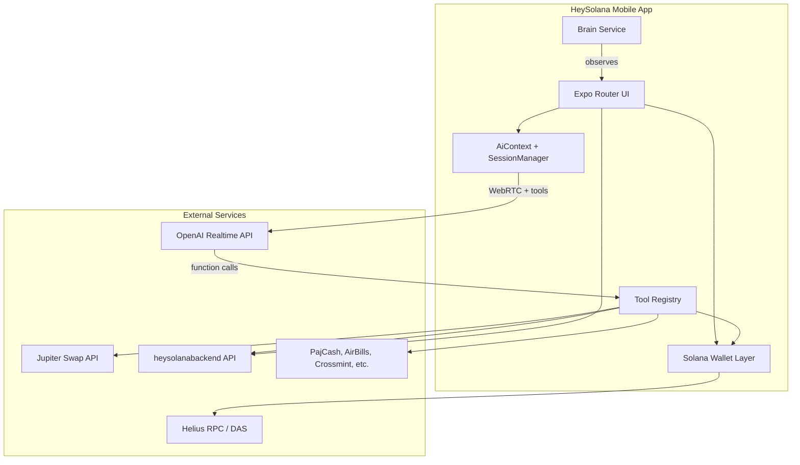

# HeySolana Wallet — Project Summary

## What this project is

**HeySolana** (package name `heysolana`) is a **mobile Solana wallet** built with **React Native and Expo**, centered on a **voice-first AI assistant**. Users can speak naturally to send crypto, swap tokens, pay bills, shop, and manage their wallet—without tapping through long forms for every action.

The product positions itself as more than a traditional wallet: it is an **agentic finance app** where OpenAI’s realtime voice API drives conversation, and **registered tools** execute on-chain and off-chain actions on the user’s behalf (with confirmation flows where money is involved).

Primary platforms: **Android** (full feature set, including picture-in-picture overlay and background services) and **iOS** (build/update pipelines exist; some native parity is still evolving per project README).

---

## Core capabilities

| Area | What users can do |
|------|-------------------|
| **Wallet** | Create/import BIP39 mnemonic, view SOL + SPL balances, send tokens, QR receive, token management |
| **Voice AI** | Real-time voice chat with the assistant (WebRTC + OpenAI Realtime); optional text chat mode |
| **Swaps** | Jupiter-powered token swaps and price checks |
| **Fiat ramps** | PajCash onramp/offramp (Naira ↔ SPL) |
| **Bills** | Airtime and electricity via AirBills |
| **Commerce** | Amazon (Crossmint), Jumia product search and orders (via Laravel backend scraper/API) |
| **Private payments** | MagicBlock private deposit/transfer/withdraw/balance |
| **Bank send** | Fiat/bank transfer flows in the send UI |
| **Apps marketplace** | Curated “apps” (integrations) with metadata in `libs/app/apps.ts` |
| **Proactive layer** | “Brain” watches conversation/tool activity and can surface notifications and suggestions |

---

## How it works (high level)



### 1. App bootstrap

On launch:

1. **`app/_layout.tsx`** — fonts, splash, bug reporting / Google Sign-In setup.
2. **`hooks/useRootBootstrap.ts`** — **`initWallet()`** (SecureStore mnemonic + Zustand), **Brain**, verified tokens, app catalog sync, pending app transactions.
3. **`app/providers/AppProviders.tsx`** — global providers: theme, AI session, PIP, widgets, push, PajCash managers, keyboard, bottom sheets.

Routing (`app/index.tsx`) sends users to onboarding, **PIN/biometric login**, or the **dashboard** depending on whether a wallet exists and auth settings are enabled.

### 2. Wallet layer

- Keys are derived from a **12-word mnemonic** (`bip39` + `ed25519-hd-key`).
- **Public key** and settings persist via Zustand + AsyncStorage; **secret phrase** lives in **SecureStore** only (modern builds).
- Balances and token accounts are fetched over **Solana RPC** (network from settings + **Helius** API key `EXPO_PUBLIC_HELIUS_API`).
- Transactions are built and signed in tool/UI code using `@solana/web3.js` and `@solana/spl-token`.

### 3. Voice & chat AI session

**`AiServiceProvider`** (`context/AiContext.tsx`) owns the assistant lifecycle:

- Creates a **`SessionManager`** wired to the active Solana `Connection`.
- **`startSession()`** opens a **WebRTC** peer connection to OpenAI’s realtime model (`gpt-realtime-mini`), streams microphone audio, and plays assistant audio back.
- **System prompt** comes from `getAssistantPromptBase()` — assistant name (default “Orova”), tone, and rules for when to call tools.
- **Tool definitions** are registered from `toolRouter()` in `libs/tool-implementation/toolsregistry.ts`.
- When the model emits a **function call**, `SessionManager` dispatches to the matching tool implementation, updates the **conversation store** (message cards, pending/complete states), and returns results to the model.
- **Chat mode** can disable voice input while keeping text + audio output.
- Optional **voice verification** (`VerifiedVoiceStream`) gates commands so only an enrolled speaker can trigger sensitive actions. Off by default; enable with `EXPO_PUBLIC_VOICE_VERIFICATION_ENABLED=true`.

Conversation history is stored in **`conversation.store`** (Zustand) for the dashboard chat UI and for Brain digest.

### 4. Tool execution model

Tools are plain objects with JSON-schema-style parameters (OpenAI function format). Each tool class receives `SessionManager` for UI callbacks (confirm sheets, navigation, loading state).

**Active tools** (representative list):

| Tool domain | Examples |
|-------------|----------|
| Wallet | `check_wallet_balance`, token search |
| Transfer | SPL/SOL sends |
| Swap | `swap_tokens`, `check_price` (Jupiter) |
| AirBills | Airtime, electricity |
| PajCash | Onramp, offramp, verify, Naira rate |
| MagicBlock | Private deposit/transfer/withdraw/balance |
| Crossmint | Amazon search, product details, orders |
| Jumia | Search, details, place order (backend-assisted) |
| App control | Router/settings/end-stream helpers for in-app navigation |

Purchases and sends typically flow through **confirmation sheets** (`PurchaseConfirmationSheet`, `ConfirmActionSheetGlobal`) before signing.

### 5. Brain (background intelligence)

**`libs/brain/Brain.ts`** runs alongside the main app:

- Subscribes to conversation/tool status changes.
- **`PriceWatcher`** can react to market moves.
- Optional **LLM digest** (`runBrainDigest`) for contextual notification copy when `EXPO_PUBLIC_BRAIN_SUGGESTIONS_LLM` or `llmEnabled` is on.
- Pushes **local notifications** for notable events (Android channel `brain-events`).

Brain is separate from the realtime voice loop; it adds proactive, session-spanning behavior.

### 6. UI architecture

- **Navigation**: [Expo Router](https://docs.expo.dev/router/introduction/) file-based routes under `app/`.
- **Main hub**: `app/dashboard/index.tsx` — wallet header, chat interface, quick actions, voice state (loading / human speaking / AI speaking) via Lottie and color themes.
- **PIP (Picture-in-Picture)**: `PIPManager` — floating overlay bubble for assistant access while using other apps (Android overlay permission).
- **Styling**: NativeWind (Tailwind) + DM Sans fonts; dark mode via `ThemeContext`.
- **State**: Zustand stores (`wallet`, `user`, `settings`, `conversation`, `tools`, `brain`, etc.).

### 7. Backend integration

The app talks to **Laravel** (`heysolanabackend`) when `EXPO_PUBLIC_API_URL` is set (e.g. `https://hey.yraytestings.com.ng/api` in production EAS updates):

- User registration, wallet address save, voice auth status
- Jumia scraping/order proxying
- Push notification token registration (FCM)
- App transaction logging, bug reports, token metadata cache

All HTTP helpers live under `utils/request/db.ts` and service modules in `services/`.

---

## Repository layout (mental map)

```
HeySolanaWallet/
├── app/                    # Screens (auth, dashboard, send, swap, settings, brain, …)
├── components/             # Reusable UI (dashboard, sheets, chat, skeletons)
├── context/                # AiContext, Theme, Keyboard, Wallet scroll
├── libs/
│   ├── brain/              # Proactive Brain service
│   ├── tool-implementation/ # Tool registry + assistant prompt
│   ├── tools/              # Per-integration tool implementations
│   ├── voiceinfra/         # WebRTC SessionManager + transcript/tool helpers
│   ├── jupiter/            # Swap/search clients
│   └── app/                # Apps marketplace metadata
├── services/               # PIP, widgets, push, bug report, transactions API
├── utils/                  # Wallet crypto/signing, stores, API client, constants
├── hooks/                  # Root bootstrap and shared hooks
├── docs/                   # Feature/architecture notes (this file, Jumia, Brain, …)
└── scripts/                # Version bump, log checking, build helpers
```

---

## Tech stack

| Layer | Technology |
|-------|------------|
| Framework | Expo ~54, React Native 0.81, React 19 |
| Routing | expo-router |
| Blockchain | `@solana/web3.js`, `@solana/spl-token`, Jupiter APIs |
| AI / voice | OpenAI Realtime (WebRTC), optional Google Gemini paths in `voiceinfra/gemini` |
| State | Zustand |
| UI | NativeWind, Reanimated, Gorhom bottom sheet, Lottie |
| Security | expo-secure-store, expo-local-authentication (PIN/biometric) |
| Updates | EAS Build + EAS Update (OTA) |
| P2P / experimental | hyperswarm, hyperdrive, bare-* (used in some advanced paths) |

---

## Configuration

Copy `.env-example` to `.env` and set keys as needed. OpenAI realtime/chat is **proxied by Laravel** (`OPENAI_API_KEY` on the server) — no client OpenAI key.

| Variable | Purpose |
|----------|---------|
| `EXPO_PUBLIC_API_URL` | Laravel backend base URL (`…/api`) |
| `EXPO_PUBLIC_HELIUS_API` | Helius RPC/API key for balances and history |
| `EXPO_PUBLIC_NETWORK` | Solana cluster RPC base |
| `EXPO_PUBLIC_JUP_API_KEY` | Jupiter Swap / token search |
| `EXPO_PUBLIC_PAJCASH_*` | Fiat ramp partner |
| `EXPO_PUBLIC_VOICE_VERIFICATION_ENABLED` | Speaker gate for AI commands (`true` / `false`) |
| `EXPO_PUBLIC_BRAIN_SUGGESTIONS_LLM` | Enable Brain LLM suggestions |
| `EXPO_PUBLIC_GOOGLE_*_CLIENT_ID` | Google Sign-In / Drive backup |

See `.env-example` for the full list (MagicBlock, Crossmint, AirBills, fees, etc.).

Production OTA scripts in `package.json` pin `EXPO_PUBLIC_API_URL` for release branches.

App version is tracked in **`app.json`** / **`package.json`** (keep them aligned; EAS local builds bump via `scripts/version-bump.js`).

---

## Related projects in the HeySolana ecosystem

| Repo | Role |
|------|------|
| **heysolanabackend** (Laravel) | API, scraping (e.g. Jumia), user/voice/push services |
| **Heysolana-admin-dashboard** | Admin/ops UI |
| **hey-solana-landing** | Marketing site |
| **HeySolana-Mobile** | Related mobile work (if split from this repo) |
| **python-speech-brain** | Speech/voice ML services (verification, etc.) |

---

## Development commands

```bash
npm install
npm run start          # Expo dev client
npm run android        # Native Android run
npm run ios            # Native iOS run (device)
npm run lint           # ESLint (expo lint)
npm run typecheck      # tsc --noEmit
npm run logs           # Device log helper (scripts/check-logs.sh)
```

Build/release flows use **EAS** (`eas build`, `eas update`) with profiles for test, production, and Solana dApp Store (Android).

---

## Design principles (product + engineering)

1. **Voice-first, tool-backed** — Natural language maps to explicit, testable tool functions; the LLM does not sign transactions directly without structured tool code and user confirmation.
2. **Mobile-native wallet security** — Mnemonic in SecureStore; optional PIN/biometric gate; public keys only in general storage.
3. **Composable integrations** — Each partner (Jupiter, PajCash, AirBills, …) is isolated under `libs/tools/<name>/`.
4. **Observable assistant UX** — Conversation store drives chat cards, tool status, and Brain side effects so users see what the agent is doing.

---

## Further reading (in-repo)

- `README.md` — Getting started, variants, and quick architecture
- `docs/AI_AGENT_THINKING_ARCHITECTURE.md` — Portable agent loop patterns (observe → decide → act → critique)
- `docs/airbills.md`, `docs/paj.cash.md`, `docs/jup-swap.md` — Integration-specific notes
- `docs/PURCHASE_SOURCE_AND_ORDERS_PLAN.md` — Commerce/order tracking design

---

*Document generated from codebase structure and implementation. For API contracts and backend behavior, see **heysolanabackend** routes and controllers.*
