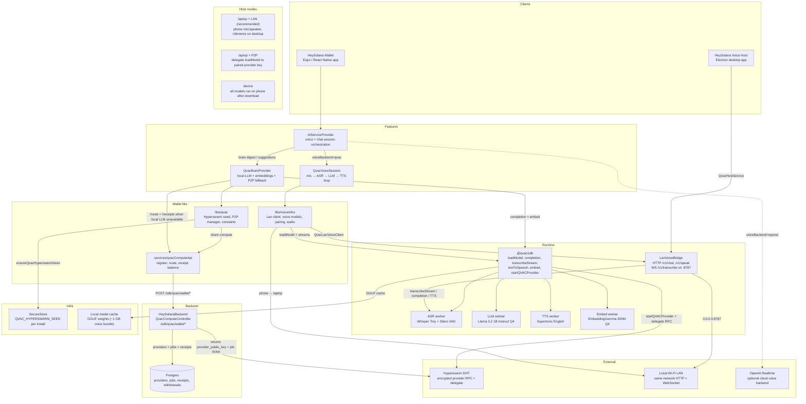

# QVAC — Private Voice Host Overview

Source: `QvacOverview.drawio.xml`

How the phone pairs with the Electron desktop host to run private voice models (ASR → LLM → TTS) locally, over LAN or P2P, with optional cloud fallback.

> Voice loop: mic PCM → transcribeStream (VAD utterances) → completion(history) → textToSpeech → speaker. Mic gated during playback + 300 ms cooldown to prevent self-hearing.

> P2P marketplace: providers register + heartbeat → consumers /route → delegate inference → /receipts/submit credits points.
