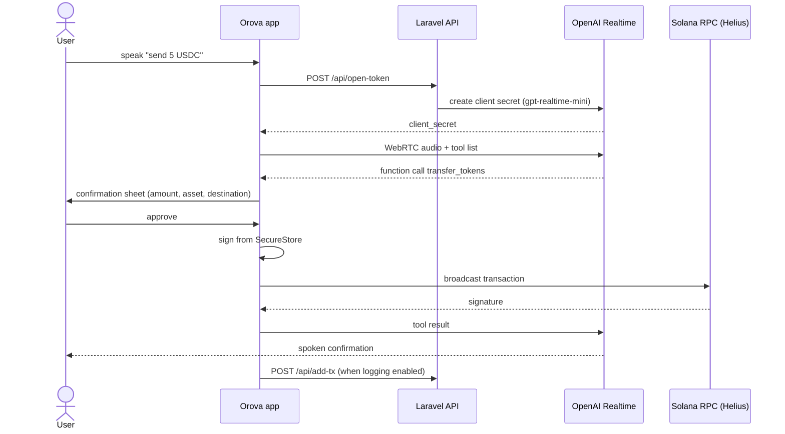

# Sequence — Solana Voice Send

Source: `SolanaVoiceSendSequence.drawio.xml`

Live path for a voice-driven Solana send. The same confirmation shape applies to Jupiter swaps, AirBills purchases, and PajCash off-ramps.

> Signing happens only after the confirmation sheet, using the on-device Solana key.
