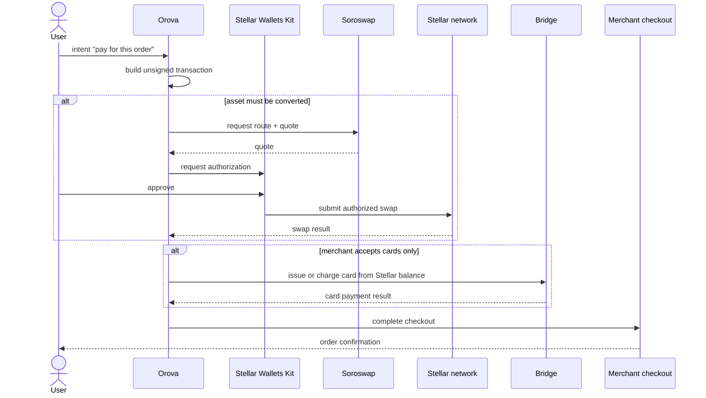

# Sequence — Stellar Commerce Payment

Source: `StellarCommerceSequence.drawio.xml`

Target flow for a spoken purchase that settles through Stellar, with Soroswap on the conversion branch and Bridge cards when the merchant cannot take Stellar.

> The agent never receives the private key. Wallets Kit is the only authorization step. Soroswap is the conversion branch.
