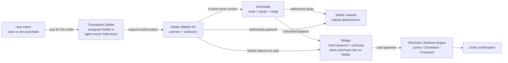

# Planned Stellar Payment Flow

Source: `StellarPaymentFlow.drawio.xml`

Target crypto-to-commerce path: user intent → Stellar wallet → Bridge (cards) → merchant checkout → order confirmation.

> The AI agent builds the transaction. Wallets Kit is the only place the user signs.
