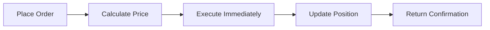
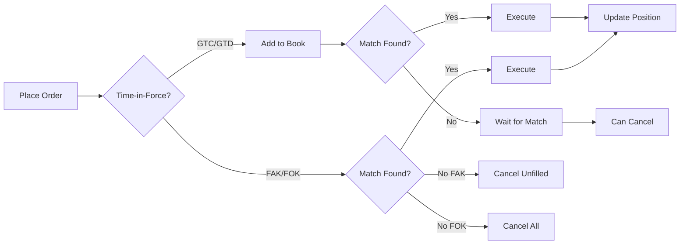

> ## Documentation Index
>
> Fetch the complete documentation index at: https://docs.bayse.markets/llms.txt
> Use this file to discover all available pages before exploring further.

# Quickstart

> Make your first API call to Bayse Markets in minutes

## Get your API credentials

Before you can trade on Bayse Markets programmatically, you need to log in and create API keys.

<Note>
  This quickstart assumes you already have a Bayse Markets account. If not, sign up at [link.bayse.markets](https://link.bayse.markets/app).
</Note>

### Step 1: Log in

Authenticate with your Bayse account to get a session token:

```bash theme={null}
curl -X POST https://relay.bayse.markets/v1/user/login \
  -H "Content-Type: application/json" \
  -d '{
    "email": "you@example.com",
    "password": "your-password"
  }'
```

<Accordion title="Response example">
  ```json  theme={null}
  {
    "token": "eyJhbGciOiJIUzI1NiIsInR5cCI6IkpXVCJ9...",
    "deviceId": "d_abc123",
    "userId": "usr_456def"
  }
  ```
</Accordion>

Save the `token` and `deviceId` — you'll need them in the next step.

### Step 2: Create an API key

Use your session token and device ID to create an API key:

```bash theme={null}
curl -X POST https://relay.bayse.markets/v1/user/me/api-keys \
  -H "x-auth-token: YOUR_TOKEN" \
  -H "x-device-id: YOUR_DEVICE_ID" \
  -H "Content-Type: application/json" \
  -d '{"name": "My API Key"}'
```

<Note>
  Each API key must have a unique name. If you already have a key called `"My API Key"`, choose a different name.
</Note>

<Accordion title="Response example">
  ```json  theme={null}
  {
    "id": "key_abc123",
    "publicKey": "pk_live_abcdef123456",
    "secretKey": "sk_live_secret789xyz",
    "name": "My API Key",
    "createdAt": "2026-02-16T10:30:00Z"
  }
  ```
</Accordion>

<Warning>
  Save your **secretKey** securely — it's only shown once! You'll use it to sign write requests.
</Warning>

### Step 3: Make a read request

Try a simple read request to list prediction market events:

```bash theme={null}
curl -X GET "https://relay.bayse.markets/v1/pm/events?limit=10" \
  -H "X-Public-Key: pk_live_abcdef123456"
```

<Accordion title="Response example">
  ```json  theme={null}
  {
    "events": [
      {
        "id": "evt_123",
        "title": "Will it rain tomorrow?",
        "category": "weather",
        "status": "active",
        "markets": [
          {
            "id": "mkt_456",
            "question": "Yes or No?",
            "outcomes": ["Yes", "No"],
            "engine": "AMM"
          }
        ]
      }
    ],
    "pagination": {
      "total": 50,
      "limit": 10,
      "offset": 0
    }
  }
  ```
</Accordion>

### Step 4: Make a signed write request

For write operations (like placing orders), you need to sign your request with HMAC-SHA256. The signing payload format is `{timestamp}.{METHOD}.{path}.{bodyHash}`:

<CodeGroup>
  ```bash cURL theme={null}
  # Set your credentials
  PUBLIC_KEY="pk_live_abcdef123456"
  SECRET_KEY="sk_live_secret789xyz"
  TIMESTAMP=$(date +%s)
  METHOD="POST"
  URL_PATH="/v1/pm/events/evt_123/markets/mkt_456/orders"
  BODY='{"side":"BUY","outcome":"YES","amount":100,"currency":"USD"}'

# Compute body hash and create signature

BODY_HASH=$(printf '%s' "$BODY" | openssl dgst -sha256 -hex 2>/dev/null | sed 's/.\*= //')
PAYLOAD="${TIMESTAMP}.${METHOD}.${URL_PATH}.${BODY_HASH}"
SIGNATURE=$(printf '%s' "$PAYLOAD" | openssl dgst -sha256 -hmac "$SECRET_KEY" -binary | base64)

# Make the request

curl -X POST "https://relay.bayse.markets${URL_PATH}" \
 -H "X-Public-Key: ${PUBLIC_KEY}" \
    -H "X-Timestamp: ${TIMESTAMP}" \
    -H "X-Signature: ${SIGNATURE}" \
    -H "Content-Type: application/json" \
    -d "$BODY"

````

```javascript Node.js theme={null}
import crypto from 'crypto';

const PUBLIC_KEY = 'pk_live_abcdef123456';
const SECRET_KEY = 'sk_live_secret789xyz';
const timestamp = Math.floor(Date.now() / 1000);
const method = 'POST';
const path = '/v1/pm/events/evt_123/markets/mkt_456/orders';
const body = JSON.stringify({ side: 'BUY', outcome: 'YES', amount: 100, currency: 'USD' });

// Compute body hash (SHA-256 hex digest)
const bodyHash = crypto.createHash('sha256').update(body).digest('hex');

// Create HMAC signature of the full payload
const payload = `${timestamp}.${method}.${path}.${bodyHash}`;
const signature = crypto
  .createHmac('sha256', SECRET_KEY)
  .update(payload)
  .digest('base64');

// Make the request
const response = await fetch(`https://relay.bayse.markets${path}`, {
  method,
  headers: {
    'X-Public-Key': PUBLIC_KEY,
    'X-Timestamp': timestamp.toString(),
    'X-Signature': signature,
    'Content-Type': 'application/json',
  },
  body,
});
````

```python Python theme={null}
import hmac
import hashlib
import base64
import json
import time
import requests

PUBLIC_KEY = 'pk_live_abcdef123456'
SECRET_KEY = 'sk_live_secret789xyz'
timestamp = int(time.time())
method = 'POST'
path = '/v1/pm/events/evt_123/markets/mkt_456/orders'
body = json.dumps({'side': 'BUY', 'outcome': 'YES', 'amount': 100, 'currency': 'USD'})

# Compute body hash and create signature
body_hash = hashlib.sha256(body.encode()).hexdigest()
payload = f'{timestamp}.{method}.{path}.{body_hash}'
signature = base64.b64encode(
    hmac.new(SECRET_KEY.encode(), payload.encode(), hashlib.sha256).digest()
).decode()

# Make the request
response = requests.post(
    f'https://relay.bayse.markets{path}',
    headers={
        'X-Public-Key': PUBLIC_KEY,
        'X-Timestamp': str(timestamp),
        'X-Signature': signature,
        'Content-Type': 'application/json',
    },
    data=body,
)
```

</CodeGroup>

<Accordion title="Response example">
  ```json  theme={null}
  {
    "id": "ord_789",
    "eventId": "evt_123",
    "marketId": "mkt_456",
    "side": "buy",
    "outcomeIndex": 0,
    "amount": 100,
    "status": "filled",
    "filledAt": "2026-02-16T10:35:00Z"
  }
  ```
</Accordion>

## Next steps

<CardGroup cols={2}>
  <Card title="Authentication guide" icon="shield-check" href="/authentication">
    Learn about API key authentication and HMAC signing in detail.
  </Card>

  <Card title="API reference" icon="book" href="/api-reference/introduction">
    Explore all available endpoints and parameters.
  </Card>

  <Card title="Prediction markets" icon="chart-line" href="/concepts/prediction-markets">
    Understand how prediction markets work on Bayse.
  </Card>

  <Card title="Error handling" icon="triangle-exclamation" href="/api-reference/introduction#errors">
    Learn how to handle API errors gracefully.
  </Card>
</CardGroup>

> ## Documentation Index
>
> Fetch the complete documentation index at: https://docs.bayse.markets/llms.txt
> Use this file to discover all available pages before exploring further.

# Authentication

> Learn how to authenticate your API requests with API keys and HMAC signatures

## Overview

Bayse Markets API uses API key authentication with HMAC-SHA256 signatures for secure request verification. Authentication requirements vary by endpoint:

- **Public endpoints**: No authentication required.
- **Read endpoints**: API key only (`X-Public-Key` header).
- **Write endpoints**: API key + timestamp + HMAC signature.

## API key structure

API keys come in pairs:

- **Public key** (`pk_*`): Identifies your API key (safe to expose in headers).
- **Secret key** (`sk_*`): Used to sign requests (keep secure, never expose).

```
Public key:  pk_live_abcdef123456
Secret key:  sk_live_secret789xyz
```

<Warning>
  Your secret key is only shown once during creation. Store it securely in environment variables or a secrets manager.
</Warning>

## Authentication levels

### Public endpoints

Some endpoints require no authentication:

```bash theme={null}
curl https://relay.bayse.markets/health
```

### Read authentication

For read operations, include your public key in the `X-Public-Key` header:

```bash theme={null}
curl -X GET "https://relay.bayse.markets/v1/pm/events" \
  -H "X-Public-Key: pk_live_abcdef123456"
```

**Endpoints requiring read authentication:**

- `GET /v1/pm/portfolio`.
- `GET /v1/pm/orders`.
- `GET /v1/pm/activities`.

### Write authentication

Write operations require three headers:

1. **X-Public-Key**: Your public API key.
2. **X-Timestamp**: Current Unix timestamp (seconds).
3. **X-Signature**: HMAC-SHA256 signature of the request payload (base64-encoded).

The signing payload format is: `{timestamp}.{METHOD}.{path}.{bodyHash}`

- **timestamp**: The same Unix timestamp sent in `X-Timestamp`.
- **METHOD**: The HTTP method in uppercase (e.g., `POST`, `DELETE`).
- **path**: The request path (e.g., `/v1/pm/orders/abc123`).
- **bodyHash**: SHA-256 hex digest of the request body. Empty string if there is no body.

```bash theme={null}
PUBLIC_KEY="pk_live_abcdef123456"
SECRET_KEY="sk_live_secret789xyz"
TIMESTAMP=$(date +%s)
METHOD="POST"
URL_PATH="/v1/pm/events/evt_123/markets/mkt_456/orders"
BODY='{"side":"BUY","outcome":"YES","amount":100,"currency":"USD"}'

# Compute body hash (SHA-256 hex digest; empty string if no body)
BODY_HASH=$(printf '%s' "$BODY" | openssl dgst -sha256 -hex 2>/dev/null | sed 's/.*= //')

# Build signing payload
PAYLOAD="${TIMESTAMP}.${METHOD}.${URL_PATH}.${BODY_HASH}"

# Create HMAC-SHA256 signature (base64-encoded)
SIGNATURE=$(printf '%s' "$PAYLOAD" | openssl dgst -sha256 -hmac "$SECRET_KEY" -binary | base64)

curl -X POST "https://relay.bayse.markets${URL_PATH}" \
  -H "X-Public-Key: ${PUBLIC_KEY}" \
  -H "X-Timestamp: ${TIMESTAMP}" \
  -H "X-Signature: ${SIGNATURE}" \
  -H "Content-Type: application/json" \
  -d "$BODY"
```

**Endpoints requiring write authentication:**

- `POST /v1/pm/events/{eventId}/markets/{marketId}/orders`.
- `DELETE /v1/pm/orders/{orderId}`.

## Implementing HMAC signatures

### How it works

1. Get the current Unix timestamp (seconds since epoch).
2. Build the signing payload: `{timestamp}.{METHOD}.{path}.{bodyHash}`.
   - If the request has a JSON body, `bodyHash` is the SHA-256 hex digest of the raw body bytes.
   - If there is no body, `bodyHash` is an empty string (the payload ends with a trailing `.`).
3. Compute the HMAC-SHA256 of the payload using your secret key.
4. Base64-encode the result.
5. Send in the `X-Signature` header along with `X-Timestamp`.

The server verifies the signature matches and the timestamp is within a 5-minute window (prevents replay attacks).

### Code examples

<CodeGroup>
  ```bash cURL theme={null}
  PUBLIC_KEY="pk_live_abcdef123456"
  SECRET_KEY="sk_live_secret789xyz"
  TIMESTAMP=$(date +%s)
  METHOD="POST"
  URL_PATH="/v1/pm/events/evt_123/markets/mkt_456/orders"
  BODY='{"side":"BUY","outcome":"YES","amount":100,"currency":"USD"}'

# Compute body hash (SHA-256 hex digest)

BODY_HASH=$(printf '%s' "$BODY" | openssl dgst -sha256 -hex 2>/dev/null | sed 's/.\*= //')

# Build signing payload and create HMAC-SHA256 signature

PAYLOAD="${TIMESTAMP}.${METHOD}.${URL_PATH}.${BODY_HASH}"
SIGNATURE=$(printf '%s' "$PAYLOAD" | openssl dgst -sha256 -hmac "$SECRET_KEY" -binary | base64)

# Make authenticated request

curl -X POST "https://relay.bayse.markets${URL_PATH}" \
 -H "X-Public-Key: ${PUBLIC_KEY}" \
    -H "X-Timestamp: ${TIMESTAMP}" \
    -H "X-Signature: ${SIGNATURE}" \
    -H "Content-Type: application/json" \
    -d "$BODY"

````

```javascript Node.js theme={null}
import crypto from 'crypto';

class BayseClient {
  constructor(publicKey, secretKey) {
    this.publicKey = publicKey;
    this.secretKey = secretKey;
    this.baseUrl = 'https://relay.bayse.markets';
  }

  createSignature(timestamp, method, path, body = null) {
    let bodyHash = '';
    if (body) {
      bodyHash = crypto.createHash('sha256').update(body).digest('hex');
    }
    const payload = `${timestamp}.${method}.${path}.${bodyHash}`;
    return crypto
      .createHmac('sha256', this.secretKey)
      .update(payload)
      .digest('base64');
  }

  async makeAuthenticatedRequest(method, path, body = null) {
    const timestamp = Math.floor(Date.now() / 1000);
    const bodyStr = body ? JSON.stringify(body) : null;
    const signature = this.createSignature(timestamp, method, path, bodyStr);

    const options = {
      method,
      headers: {
        'X-Public-Key': this.publicKey,
        'X-Timestamp': timestamp.toString(),
        'X-Signature': signature,
        'Content-Type': 'application/json',
      },
    };

    if (bodyStr) {
      options.body = bodyStr;
    }

    const response = await fetch(`${this.baseUrl}${path}`, options);
    return response.json();
  }

  async placeOrder(eventId, marketId, order) {
    return this.makeAuthenticatedRequest(
      'POST',
      `/v1/pm/events/${eventId}/markets/${marketId}/orders`,
      order
    );
  }
}

// Usage
const client = new BayseClient(
  'pk_live_abcdef123456',
  'sk_live_secret789xyz'
);

await client.placeOrder('evt_123', 'mkt_456', {
  side: 'BUY',
  outcome: 'YES',
  amount: 100,
  currency: 'USD',
});
````

```python Python theme={null}
import hmac
import hashlib
import base64
import json
import time
import requests

class BayseClient:
    def __init__(self, public_key, secret_key):
        self.public_key = public_key
        self.secret_key = secret_key
        self.base_url = 'https://relay.bayse.markets'

    def create_signature(self, timestamp, method, path, body=None):
        """Create HMAC-SHA256 signature of the request payload"""
        body_hash = ''
        if body:
            body_hash = hashlib.sha256(body.encode()).hexdigest()
        payload = f'{timestamp}.{method}.{path}.{body_hash}'
        return base64.b64encode(
            hmac.new(
                self.secret_key.encode(),
                payload.encode(),
                hashlib.sha256
            ).digest()
        ).decode()

    def make_authenticated_request(self, method, path, body=None):
        """Make authenticated API request"""
        timestamp = int(time.time())
        body_str = json.dumps(body) if body else None
        signature = self.create_signature(timestamp, method, path, body_str)

        headers = {
            'X-Public-Key': self.public_key,
            'X-Timestamp': str(timestamp),
            'X-Signature': signature,
            'Content-Type': 'application/json',
        }

        response = requests.request(
            method,
            f'{self.base_url}{path}',
            headers=headers,
            data=body_str,
        )
        return response.json()

    def place_order(self, event_id, market_id, order):
        """Place a prediction market order"""
        return self.make_authenticated_request(
            'POST',
            f'/v1/pm/events/{event_id}/markets/{market_id}/orders',
            body=order,
        )

# Usage
client = BayseClient(
    'pk_live_abcdef123456',
    'sk_live_secret789xyz'
)

result = client.place_order('evt_123', 'mkt_456', {
    'side': 'BUY',
    'outcome': 'YES',
    'amount': 100,
    'currency': 'USD',
})
```

```go Go theme={null}
package main

import (
    "crypto/hmac"
    "crypto/sha256"
    "encoding/base64"
    "encoding/hex"
    "fmt"
    "strconv"
    "time"
)

type BayseClient struct {
    PublicKey string
    SecretKey string
    BaseURL   string
}

func NewBayseClient(publicKey, secretKey string) *BayseClient {
    return &BayseClient{
        PublicKey: publicKey,
        SecretKey: secretKey,
        BaseURL:   "https://relay.bayse.markets",
    }
}

func (c *BayseClient) CreateSignature(timestamp int64, method, path string, body []byte) string {
    bodyHash := ""
    if len(body) > 0 {
        h := sha256.Sum256(body)
        bodyHash = hex.EncodeToString(h[:])
    }
    payload := fmt.Sprintf("%d.%s.%s.%s", timestamp, method, path, bodyHash)
    mac := hmac.New(sha256.New, []byte(c.SecretKey))
    mac.Write([]byte(payload))
    return base64.StdEncoding.EncodeToString(mac.Sum(nil))
}

func (c *BayseClient) GetAuthHeaders(method, path string, body []byte) map[string]string {
    timestamp := time.Now().Unix()
    signature := c.CreateSignature(timestamp, method, path, body)

    return map[string]string{
        "X-Public-Key": c.PublicKey,
        "X-Timestamp":  strconv.FormatInt(timestamp, 10),
        "X-Signature":  signature,
        "Content-Type": "application/json",
    }
}

// Usage
func main() {
    client := NewBayseClient(
        "pk_live_abcdef123456",
        "sk_live_secret789xyz",
    )

    body := []byte(`{"side":"BUY","outcome":"YES","amount":100,"currency":"USD"}`)
    headers := client.GetAuthHeaders("POST", "/v1/pm/events/evt_123/markets/mkt_456/orders", body)
    fmt.Printf("Headers: %+v\n", headers)
}
```

</CodeGroup>

## Social sign-in users

If you signed up for Bayse using **Apple** or **Google**, your account doesn't have a password yet. The API requires email and password authentication to create and manage API keys.

To set up a password:

1. Open the Bayse app and go to **Forgot Password** (or use the password reset flow).
2. Enter the email associated with your Apple/Google account.
3. Follow the instructions to create a password.

Once you've set a password, you can use it with the [login endpoint](#getting-a-session-token) to get a session token and start managing API keys.

<Note>
  Setting a password does **not** change or remove your existing sign-in method. You can continue using Apple or Google to sign in to the Bayse app as usual. The password is only needed for API access.
</Note>

<Warning>
  There is currently no web UI for managing API keys — all key management is done through the API. See the [Quickstart](/quickstart) guide to get started.
</Warning>

## Managing API keys

### Getting a session token

Before you can create or manage API keys, you need to log in with your Bayse account credentials to get a session token and device ID:

```bash theme={null}
curl -X POST https://relay.bayse.markets/v1/user/login \
  -H "Content-Type: application/json" \
  -d '{
    "email": "you@example.com",
    "password": "your-password"
  }'
```

<Accordion title="Response">
  ```json  theme={null}
  {
    "token": "eyJhbGciOiJIUzI1NiIsInR5cCI6IkpXVCJ9...",
    "deviceId": "d_abc123",
    "userId": "usr_456def"
  }
  ```
</Accordion>

Use the `token` and `deviceId` from the response as the `x-auth-token` and `x-device-id` headers for all API key management requests below.

<Note>
  The login endpoint is rate-limited to 1 request per 2 minutes per email address. Cache your session token and reuse it. See [Rate limits](/rate-limits) for details.
</Note>

### Creating API keys

With your session token and device ID, create an API key:

```bash theme={null}
curl -X POST https://relay.bayse.markets/v1/user/me/api-keys \
  -H "x-auth-token: YOUR_TOKEN" \
  -H "x-device-id: YOUR_DEVICE_ID" \
  -H "Content-Type: application/json" \
  -d '{"name": "Production API Key"}'
```

<Accordion title="Response">
  ```json  theme={null}
  {
    "id": "key_abc123",
    "publicKey": "pk_live_abcdef123456",
    "secretKey": "sk_live_secret789xyz",
    "name": "Production API Key",
    "createdAt": "2026-02-16T10:30:00Z"
  }
  ```
</Accordion>

### Listing API keys

```bash theme={null}
curl -X GET https://relay.bayse.markets/v1/user/me/api-keys \
  -H "x-auth-token: YOUR_TOKEN" \
  -H "x-device-id: YOUR_DEVICE_ID"
```

### Revoking API keys

```bash theme={null}
curl -X DELETE https://relay.bayse.markets/v1/user/me/api-keys/key_abc123 \
  -H "x-auth-token: YOUR_TOKEN" \
  -H "x-device-id: YOUR_DEVICE_ID"
```

### Rotating API keys

Generate a new secret key while keeping the same public key:

```bash theme={null}
curl -X POST https://relay.bayse.markets/v1/user/me/api-keys/key_abc123/rotate \
  -H "x-auth-token: YOUR_TOKEN" \
  -H "x-device-id: YOUR_DEVICE_ID"
```

<Accordion title="Response">
  ```json  theme={null}
  {
    "id": "key_abc123",
    "publicKey": "pk_live_abcdef123456",
    "secretKey": "sk_live_newsecret456def",
    "name": "Production API Key",
    "rotatedAt": "2026-02-16T11:00:00Z"
  }
  ```
</Accordion>

## Security best practices

<AccordionGroup>
  <Accordion title="Store credentials securely" icon="lock">
    * Never commit API keys to version control
    * Use environment variables or secrets managers
    * Rotate keys regularly
    * Use separate keys for development and production
  </Accordion>

  <Accordion title="Protect your secret key" icon="shield-halved">
    * Never expose secret keys in client-side code
    * Don't log secret keys
    * Revoke compromised keys immediately
    * The secret key is only shown once - save it during creation
  </Accordion>

  <Accordion title="Implement proper error handling" icon="triangle-exclamation">
    * Don't expose secret keys in error messages
    * Handle authentication errors gracefully
    * Implement retry logic with exponential backoff
    * Monitor for suspicious authentication patterns
  </Accordion>

  <Accordion title="Use HTTPS" icon="globe">
    * Always use HTTPS in production
    * Verify SSL certificates
    * Never send credentials over HTTP
  </Accordion>
</AccordionGroup>

## Common errors

### Invalid signature

```json theme={null}
{
  "error": "invalid_signature",
  "message": "The provided signature does not match the expected signature"
}
```

**Causes:**

- Incorrect secret key.
- Timestamp mismatch (signed different timestamp than sent in `X-Timestamp`).
- Wrong payload format — must be `{timestamp}.{METHOD}.{path}.{bodyHash}`.
- Body hash mismatch — the exact bytes sent in the request body must match what was hashed when signing. Avoid trimming or reformatting the body after signing.
- Incorrect HMAC algorithm (must be SHA-256).
- Incorrect encoding (signature must be base64, body hash must be hex).

### Timestamp too old

```json theme={null}
{
  "error": "timestamp_expired",
  "message": "Request timestamp is too old"
}
```

**Cause:** The timestamp in `X-Timestamp` is too far in the past. Ensure your system clock is synchronized.

### Missing API key

```json theme={null}
{
  "error": "unauthorized",
  "message": "API key is required for this endpoint"
}
```

**Cause:** The `X-Public-Key` header is missing or invalid.

## Next steps

<CardGroup cols={2}>
  <Card title="API reference" icon="book" href="/api-reference/introduction">
    Explore all available endpoints
  </Card>

  <Card title="Prediction markets" icon="chart-line" href="/concepts/prediction-markets">
    Learn about prediction market operations
  </Card>

  <Card title="User endpoints" icon="user" href="/api-reference/user/create-api-key">
    Manage your API keys programmatically
  </Card>
</CardGroup>

> ## Documentation Index
>
> Fetch the complete documentation index at: https://docs.bayse.markets/llms.txt
> Use this file to discover all available pages before exploring further.

# Prediction markets

> Understanding prediction markets on Bayse

## What are prediction markets?

Prediction markets allow users to trade on the outcomes of future events. Users buy and sell shares in different outcomes, and the market prices reflect the collective wisdom of all participants.

**Example:**

**Event**: "Will it rain in Lagos tomorrow?"

**Outcomes**:

- Yes (currently trading at \$0.65)
- No (currently trading at \$0.35)

If you think rain is more likely than 65%, you might buy "Yes" shares. If it does rain, your shares are worth \$1.00 each. If it doesn't, they're worth \$0.00.

## Learn more

<CardGroup cols={3}>
  <Card title="Events, markets & outcomes" icon="sitemap" href="/concepts/events-markets-outcomes">
    The data model — events, markets, outcomes, and event types
  </Card>

  <Card title="Market engines" icon="gears" href="/concepts/market-engines">
    AMM vs CLOB execution
  </Card>

  <Card title="Multi-currency" icon="coins" href="/concepts/multi-currency">
    Trading in USD and NGN
  </Card>

  <Card title="Trading flow" icon="arrow-right-arrow-left" href="/concepts/trading-flow">
    Browse, quote, order, and portfolio
  </Card>

  <Card title="Order lifecycle" icon="clock-rotate-left" href="/concepts/order-lifecycle">
    Time-in-force, order types, and statuses
  </Card>

  <Card title="Market data" icon="chart-line" href="/concepts/market-data">
    Price history, order book, trades, and ticker
  </Card>
</CardGroup>

> ## Documentation Index
>
> Fetch the complete documentation index at: https://docs.bayse.markets/llms.txt
> Use this file to discover all available pages before exploring further.

# Events, markets & outcomes

> The data model behind Bayse prediction markets

## Hierarchy

Bayse uses a three-level hierarchy:

**Event → Market → Outcome**

- An **event** is the top-level container. It represents a real-world question or topic — for example, "NBA Finals 2025" or "Will it rain in Lagos tomorrow?".
- A **market** is a tradeable question within an event. Each market has exactly **two outcomes** (e.g. YES/NO, or two named options). Prices for the two outcomes always sum to approximately 1.00.
- An **outcome** is one side of a market that you can buy or sell shares in. Each outcome has a unique UUID (`outcomeId`) that you use when placing orders or getting quotes.

## Events

Events group one or more related markets together. Every event has a `type` that determines how its markets relate to each other.

**Key fields:**

- `title` — the headline question or topic.
- `type` — `single`, `combined`, or `grouped` (see [Event types](#event-types)).
- `category` — sports, politics, crypto, entertainment, etc.
- `status` — `open`, `closed`, `resolved`, `cancelled`, `paused`, or `draft`.
- `engine` — `AMM` or `CLOB` (see [Market engines](/concepts/market-engines)).
- `closingDate` — when trading closes.
- `resolutionDate` — when the outcome is determined.

## Markets and outcomes

Each market is a binary question with two outcomes. You trade by buying or selling shares in one of the outcomes.

**Key fields:**

- `title` — the specific question (e.g. "Will Lakers win?").
- `outcome1Id` / `outcome2Id` — UUIDs that uniquely identify each outcome.
- `outcome1Label` / `outcome2Label` — labels for each side (e.g. "YES" / "NO").
- `outcome1Price` / `outcome2Price` — current probability prices (0.00–1.00).
- `rules` — resolution criteria for this market.
- `status` — same set as events.

The `outcomeId` is the canonical way to reference an outcome. When you fetch a market, note the `outcome1Id` and `outcome2Id` — you'll use one of these when placing orders or requesting quotes.

## Event types

<AccordionGroup>
  <Accordion title="Single market" icon="circle-1">
    One event, one market, two outcomes. The event title and market title are typically the same.

    ```json  theme={null}
    {
      "title": "Will it rain in Lagos tomorrow?",
      "type": "single",
      "markets": [
        {
          "title": "Will it rain in Lagos tomorrow?",
          "outcome1Id": "c3d4e5f6-a7b8-9012-cdef-123456789012",
          "outcome1Label": "YES",
          "outcome1Price": 0.65,
          "outcome2Id": "d4e5f6a7-b8c9-0123-defa-234567890123",
          "outcome2Label": "NO",
          "outcome2Price": 0.35
        }
      ]
    }
    ```

  </Accordion>

  <Accordion title="Combined market" icon="circle-2">
    Multiple **mutually exclusive** markets under one event. Only one market can resolve YES — when one wins, the others automatically resolve NO.

    ```json  theme={null}
    {
      "title": "NBA Finals 2025 Winner",
      "type": "combined",
      "markets": [
        {
          "title": "Will Lakers win?",
          "outcome1Id": "...",
          "outcome1Label": "YES",
          "outcome1Price": 0.35,
          "outcome2Id": "...",
          "outcome2Label": "NO",
          "outcome2Price": 0.65
        },
        {
          "title": "Will Celtics win?",
          "outcome1Id": "...",
          "outcome1Label": "YES",
          "outcome1Price": 0.40,
          "outcome2Id": "...",
          "outcome2Label": "NO",
          "outcome2Price": 0.60
        },
        {
          "title": "Will Nuggets win?",
          "outcome1Id": "...",
          "outcome1Label": "YES",
          "outcome1Price": 0.25,
          "outcome2Id": "...",
          "outcome2Label": "NO",
          "outcome2Price": 0.75
        }
      ]
    }
    ```

  </Accordion>

  <Accordion title="Grouped market" icon="circle-3">
    Multiple **independent** markets under one event. Each market is resolved on its own — multiple markets can resolve YES.

    ```json  theme={null}
    {
      "title": "Player stats: Lakers vs Celtics",
      "type": "grouped",
      "markets": [
        {
          "title": "Will LeBron score 30+ points?",
          "outcome1Id": "...",
          "outcome1Label": "YES",
          "outcome1Price": 0.45,
          "outcome2Id": "...",
          "outcome2Label": "NO",
          "outcome2Price": 0.55
        },
        {
          "title": "Will Tatum score 25+ points?",
          "outcome1Id": "...",
          "outcome1Label": "YES",
          "outcome1Price": 0.60,
          "outcome2Id": "...",
          "outcome2Label": "NO",
          "outcome2Price": 0.40
        }
      ]
    }
    ```

  </Accordion>
</AccordionGroup>

## Finding markets

Use the `keyword` query parameter on the [List events](/api-reference/pm/list-events) endpoint to search for events by title:

```bash theme={null}
GET /v1/pm/events?keyword=lagos&status=open
```

You can also filter by `category`, `status`, `trending`, and more. See the [List events](/api-reference/pm/list-events) reference for all available filters.

> ## Documentation Index
>
> Fetch the complete documentation index at: https://docs.bayse.markets/llms.txt
> Use this file to discover all available pages before exploring further.

# Market engines

> AMM and CLOB execution on Bayse

Bayse supports two types of market engines. Each event uses one engine for all of its markets.

## AMM (Automated Market Maker)

- Algorithmic pricing based on supply/demand.
- No order book — instant execution.
- Price adjusts automatically after each trade.
- Liquidity is always available, however depth depends on individual markets.

**Example trade:**

```json theme={null}
{
  "side": "BUY",
  "outcome": "YES",
  "amount": 100,
  "currency": "USD"
}
```

## CLOB (Central Limit Order Book)

- Traditional order book with bids and asks.
- Users place limit orders at specific prices.
- Orders match when prices overlap.
- Liquidity depth is determined by market participants.

**Example trade:**

```json theme={null}
{
  "side": "BUY",
  "outcome": "YES",
  "amount": 100,
  "price": 0.65,
  "currency": "USD"
}
```

The `engine` field on an event tells you which engine it uses. See [Order lifecycle](/concepts/order-lifecycle) for how orders behave differently under each engine.

> ## Documentation Index
>
> Fetch the complete documentation index at: https://docs.bayse.markets/llms.txt
> Use this file to discover all available pages before exploring further.

# Multi-currency support

> Trading in USD and NGN on Bayse

All market prices are quoted as probabilities (0.00 to 1.00), but amounts are in your chosen currency.

## Supported currencies

- **USD** — US Dollar (default).
- **NGN** — Nigerian Naira.

## Currency base multiplier

Each currency has a base multiplier that determines how probabilities convert to costs:

| Currency | Base multiplier | Price of 0.65 | Winning payout |
| -------- | --------------- | ------------- | -------------- |
| USD      | 1               | \$0.65/share  | \$1.00/share   |
| NGN      | 100             | ₦65.00/share  | ₦100.00/share  |

The cost per share is: `price × base multiplier`. Losing shares pay out **0.00**.

## Specifying currency

Add the `currency` query parameter to your requests:

```bash theme={null}
# Get events with prices in NGN
GET /v1/pm/events?currency=NGN

# Get a specific event in USD (default)
GET /v1/pm/events/evt_123?currency=USD

# Place an order in NGN
POST /v1/pm/events/evt_123/markets/mkt_456/orders
{
  "side": "BUY",
  "outcome": "YES",
  "amount": 10000,
  "currency": "NGN"
}
```

If you don't specify a currency, USD is used by default.

Built with [Mintlify](https://mintlify.com).

> ## Documentation Index
>
> Fetch the complete documentation index at: https://docs.bayse.markets/llms.txt
> Use this file to discover all available pages before exploring further.

# Trading flow

> How to browse, quote, trade, and manage positions on Bayse

## 1. Browse events

List available events filtered by category, status, or search terms:

```bash theme={null}
GET /v1/pm/events?category=sports&status=open
```

See [Finding markets](/concepts/events-markets-outcomes#finding-markets) for more filtering options.

## 2. Get quote

Before placing an order, get a quote to see the expected price:

```bash theme={null}
POST /v1/pm/events/{eventId}/markets/{marketId}/quote
{
  "side": "BUY",
  "outcome": "YES",
  "amount": 100
}
```

**Response:**

```json theme={null}
{
  "expectedPrice": 0.6532,
  "expectedShares": 153.12,
  "fee": 2.5,
  "total": 102.5
}
```

## 3. Place order

Execute the trade:

```bash theme={null}
POST /v1/pm/events/{eventId}/markets/{marketId}/orders
{
  "side": "BUY",
  "outcome": "YES",
  "amount": 100
}
```

## 4. View portfolio

Check your positions:

```bash theme={null}
GET /v1/pm/portfolio
```

## Positions and orders

**Positions** are your holdings in a specific market outcome:

- **Shares** — number of shares owned.
- **Average price** — average price paid per share.
- **Current value** — current market value.
- **Unrealized P\&L** — profit/loss if sold at current price.

**Orders** are instructions to buy or sell shares:

- **Side** — buy or sell.
- **Outcome** — which outcome to trade.
- **Amount** — how much to spend/receive.
- **Status** — pending, filled, cancelled.

See [Order lifecycle](/concepts/order-lifecycle) for details on how orders execute and progress through statuses.

Built with [Mintlify](https://mintlify.com).

> ## Documentation Index
>
> Fetch the complete documentation index at: https://docs.bayse.markets/llms.txt
> Use this file to discover all available pages before exploring further.

# Order lifecycle

> How orders execute and progress through statuses

## AMM orders



AMM orders execute instantly at the calculated price.

## CLOB orders



CLOB orders support different execution strategies through time-in-force options.

## Time-in-force options

- **GTC (Good Till Cancel)** — stays on the book until filled or manually cancelled. Default for limit orders.
- **FAK (Fill and Kill)** — execute as much as possible immediately, cancel any unfilled portion.
- **FOK (Fill or Kill)** — execute entirely or cancel completely. No partial fills.
- **GTD (Good Till Date)** — remains active until a specified expiry time.

## Order types

- **Limit orders** — specify the max price you'll pay (buy) or min price you'll accept (sell). Execute at your price or better.
- **Market orders** — execute immediately at the best available price.

## Order statuses

1. **pending** — order received and being validated.
2. **open** — active on the book, waiting for matches.
3. **partial_filled** — some shares executed, remainder still on book (GTC/GTD only).
4. **filled** — completely executed.
5. **cancelled** — cancelled by user or system.
6. **rejected** — failed validation.
7. **expired** — GTD order reached expiry time without filling.

Built with [Mintlify](https://mintlify.com).

> ## Documentation Index
>
> Fetch the complete documentation index at: https://docs.bayse.markets/llms.txt
> Use this file to discover all available pages before exploring further.

# Market data

> Price history, order books, trades, and ticker data

## Price history

Historical prices for market outcomes:

```bash theme={null}
GET /v1/pm/events/{eventId}/price-history?interval=1h
```

## Order book

Current bids and asks (CLOB markets only):

```bash theme={null}
GET /v1/pm/books?marketId={marketId}
```

## Recent trades

Executed trades (CLOB markets only):

```bash theme={null}
GET /v1/pm/trades?marketId={marketId}
```

## Ticker

Real-time market statistics (CLOB markets only):

```bash theme={null}
GET /v1/pm/markets/{marketId}/ticker
```

For real-time streaming data, see the [WebSocket](/websocket/introduction) documentation.

Built with [Mintlify](https://mintlify.com).

> ## Documentation Index
>
> Fetch the complete documentation index at: https://docs.bayse.markets/llms.txt
> Use this file to discover all available pages before exploring further.

# Liquidity rewards

> Earn rewards by providing liquidity on CLOB markets

Bayse rewards users who maintain resting limit orders on CLOB markets. If you keep tight, two-sided quotes near the midpoint, you earn a share of a per-market reward pool paid out at the end of each epoch.

## How it works

1. **Place limit orders** on both sides (bid and ask) of a CLOB market.
2. **Keep orders resting** — the system samples the orderbook every minute and scores qualifying orders.
3. **Get paid** — at the end of each epoch, your share of the reward pool is credited to your wallet.

Markets with active liquidity rewards include a `liquidityReward` field in their event data:

```json theme={null}
{
  "liquidityReward": {
    "configId": "aa9024a6-fca5-4ed8-a5b9-124584d61f04",
    "rewardPool": 100.0,
    "maxSpreadCents": 5,
    "minNotionalOrderSize": 5.0
  }
}
```

If the field is `null` or absent, the market has no active reward program.

All amounts in `liquidityReward` (`rewardPool`, `maxSpreadCents`, `minNotionalOrderSize`) are denominated in USD. To convert to another currency, multiply by that currency's base multiplier. For example, a `maxSpreadCents` of 5 (i.e., \$0.05) becomes ₦5.00 in NGN (0.05 × 100). See [Multi-currency support](/concepts/multi-currency) for the full list of multipliers.

## Eligibility

For an order to count toward your score in a given sample:

- **Minimum notional value** — `remaining shares * price` must meet the market's `minNotionalOrderSize`.
- **Maximum spread** — the order must be within `maxSpreadCents` cents of the current midpoint (e.g., 5 cents = 0.05).
- **Minimum rest time** — the order must have been resting on the book for at least a few seconds (typically 3s). This prevents rapid place-cancel cycling.

## Scoring

Each qualifying order is scored based on how close it is to the midpoint:

- **Tighter orders score higher.** An order right at the midpoint gets full weight; an order at the edge of the qualifying spread gets zero.
- **Larger orders score higher.** Score is proportional to remaining order size multiplied by the tightness weight.

Your per-sample score is the sum of all your qualifying orders' scores.

### Two-sided quoting bonus

Users who quote both sides (bid and ask) earn significantly more than single-sided quoters.

- If you only quote one side, your score is divided by a penalty factor (e.g., 3x).
- If you quote both sides roughly equally, you earn close to your full score.
- At extreme prices (below 0.10 or above 0.90), only balanced two-sided quoting is rewarded — single-sided liquidity earns zero.

## Epochs and payouts

Rewards are distributed in **epochs** — fixed time windows (commonly 24 hours). At the end of each epoch:

1. Your time-weighted average share is computed from all the samples you participated in.
2. Your payout is `rewardPool * (your average share)`.
3. The amount is converted to your trading currency and credited to your wallet.

If you were active for only part of an epoch, your payout scales proportionally. For example, if you maintained a 10% share but were only present for half the sampling periods, you receive approximately 5% of the pool.

## Tracking your rewards

Use the API to monitor your rewards:

- **[GET /v1/pm/liquidity-rewards](/api-reference/pm/liquidity-rewards)** — paginated history of completed epoch payouts.
- **[GET /v1/pm/liquidity-rewards/active](/api-reference/pm/liquidity-rewards-active)** — in-progress accumulation with estimated payouts that update in real time.

## Tips for maximizing rewards

- **Quote both sides.** The two-sided bonus is substantial — even small orders on your weaker side improve your score.
- **Stay tight.** Orders closer to the midpoint are weighted much more heavily than those near the edge.
- **Stay consistent.** Rewards are sampled every minute, so orders that remain on the book accumulate more samples.
- **Size matters.** Larger resting orders earn proportionally more, but only if they remain within the qualifying spread.

Built with [Mintlify](https://mintlify.com).
